# Sprint 4 Reports & AI Complete Audit

## 1. Sprint Overview

- **Sprint name:** Reports & AI Intelligence.
- **Position in project:** Documented here as Sprint 4 of the PFE project. TO VERIFY: the existing internship plan labels reports, AI, Telegram, and n8n as Sprint 5 in `docs/internship-report/05-three-month-sprint-plan.md:54-64`, while this prompt asks for Sprint 4.
- **Main objective:** This sprint transforms stored telemetry, server metrics, maintenance activity, and team communication events into decision-support features. The implemented code includes report generation, metrics aggregation, anomaly detection, Groq-backed summaries with fallback text, rule-based predictive maintenance, an AI Chat assistant, in-app notifications, Telegram account linking, Telegram outgoing alerts, and optional n8n webhook dispatch.

High-level deliverables:

- Report list, detail, creation, and AI-summary regeneration routes are defined in `routes/web.php:123-128`.
- Report generation reads real sensor and server metrics, computes snapshots, persists reports, stores AI/fallback summaries, sends Telegram critical alerts, sends an optional n8n webhook, audits generation, and broadcasts a report event in `app/Services/Reports/ReportGenerationService.php:32-90`.
- Metrics and anomaly calculations are implemented in `app/Services/Reports/ReportMetricsCalculator.php:9-155`.
- The database report provider queries `sensor_readings` and `server_metrics` for a selected period in `app/Services/Reports/DatabaseSensorDataProvider.php:89-109`.
- Groq report summaries use the OpenAI-compatible `/chat/completions` endpoint with deterministic fallback behavior in `app/Services/Reports/GroqReportSummaryService.php:11-170`.
- AI Chat uses the same Groq configuration, stores conversation history in the session, and falls back when Groq is unavailable in `app/Http/Controllers/AIChatController.php:28-92` and `app/Services/AIChatService.php:19-121`.
- Rule-based predictive maintenance recommendations are added to the report snapshot in `app/Services/Reports/ReportGenerationService.php:35-38` and generated in `app/Services/PredictiveMaintenanceService.php:7-58`.
- Telegram account linking and webhook handling are implemented in `app/Http/Controllers/TelegramController.php:37-121`.
- Telegram outgoing messages for maintenance assignment, chat mention, and critical reports are sent through `app/Services/TelegramService.php:44-108` and `app/Services/Reports/ReportGenerationService.php:61-75`.
- Optional n8n webhook dispatch after report generation is implemented in `app/Services/Reports/ReportGenerationService.php:131-172`.

Dependencies on previous sprints:

- Reports consume environmental telemetry from `sensor_readings` through `SensorReading` queries in `app/Services/Reports/DatabaseSensorDataProvider.php:91-94`.
- Reports consume server metrics from `server_metrics` through `ServerMetric` queries in `app/Services/Reports/DatabaseSensorDataProvider.php:96-99`.
- All report and AI Chat pages depend on the authentication sprint because the route group requires `auth`, `approved.user`, and `verified` middleware in `routes/web.php:123-158`.
- Telegram linking depends on the user model storing `telegram_chat_id` and `telegram_link_token` in `app/Models/User.php:54-78`.

Position in the overall project:

This sprint sits above the telemetry and operations layers. It does not create raw measurements; it analyzes stored measurements and operational records to support reporting, alerts, and decisions. It also extends the platform beyond the browser through Telegram and n8n integration.

## 2. Functional Requirements Covered

- Daily, weekly, and monthly report **types** are supported by validation in `app/Http/Requests/StoreReportRequest.php:15-20` and period resolution in `app/Services/Reports/ReportGenerationService.php:175-197`.
- Automatic daily, weekly, and monthly generation is **not implemented in the inspected code**; `routes/console.php:6-8` only registers the default `inspire` command, and no `app/Console` directory is present in the inspected tree.
- Manual on-demand report generation is implemented by `POST /reports` in `routes/web.php:124-125` and `app/Http/Controllers/ReportController.php:54-89`.
- AI-generated executive summaries with structured JSON output are requested from Groq in `app/Services/Reports/GroqReportSummaryService.php:22-61`.
- Fallback summaries are generated when Groq configuration is missing, the request fails, the response is malformed, or an exception occurs in `app/Services/Reports/GroqReportSummaryService.php:18-20`, `app/Services/Reports/GroqReportSummaryService.php:42-50`, and `app/Services/Reports/GroqReportSummaryService.php:62-170`.
- Predictive maintenance recommendations are rule-based and added to report snapshots in `app/Services/PredictiveMaintenanceService.php:7-58`.
- Temperature prediction through a FastAPI sidecar exists as `TemperaturePredictionService`, but it is not wired to a user-facing Laravel flow; only the service class references itself in `app/Services/TemperaturePredictionService.php:7-24`.
- The committed FastAPI temperature sidecar exposes `POST /predict` for one temperature value and returns prediction, failure probability, and risk level in `ml_service/predict_api.py:20-39`.
- AI Chat conversational assistant routes are defined in `routes/web.php:134-136` and implemented in `app/Http/Controllers/AIChatController.php:28-92`.
- Telegram account linking via deep-link token is implemented in `app/Http/Controllers/TelegramController.php:37-57`.
- Telegram webhook handling for `/start connect_<token>` is implemented in `app/Http/Controllers/TelegramController.php:68-121`.
- Telegram maintenance assignment messages are sent in `app/Services/TelegramService.php:75-91`.
- Telegram mention alerts are sent in `app/Services/TelegramService.php:93-108`.
- Telegram critical-report alerts are sent to approved Department Heads with `telegram_chat_id` in `app/Services/Reports/ReportGenerationService.php:61-75`.
- Critical-report email alerts via Brevo SMTP are **not implemented as a Sprint 4 notification/mail class** in the inspected repository; the available mail configuration is generic SMTP in `config/mail.php:19-52`, and `app/Mail` is not present.
- n8n webhook dispatch after report generation is optional and controlled by `services.n8n.report_webhook_url` in `config/services.php:76-79` and `app/Services/Reports/ReportGenerationService.php:131-172`.
- Audit logging exists for report generation and regenerated summaries in `app/Services/Reports/ReportGenerationService.php:77-84` and `app/Services/Reports/ReportGenerationService.php:100-105`; AI Chat, Telegram sends, and n8n dispatch are not individually audited in the inspected code.

## 3. Actors and Triggers

| Actor / Trigger | Action | File:line |
|---|---|---|
| Department Head | Can open reports, manually generate reports, regenerate summaries, and use AI Chat because these routes are in the authenticated approved verified group. | `routes/web.php:123-137` |
| Staff | Can also open reports, manually generate reports, regenerate summaries, and use AI Chat because report routes are not wrapped in `department.head`. | `routes/web.php:123-137`; `app/Http/Requests/StoreReportRequest.php:10-13` |
| Scheduler | No report scheduler was found; only the default `inspire` command is registered. | `routes/console.php:6-8` |
| External Telegram Bot API | Posts webhook updates to the public Telegram endpoint. | `routes/web.php:65-65`; `app/Http/Controllers/TelegramController.php:68-121` |
| n8n | Passive receiver of optional report webhook payloads after a report is generated. | `config/services.php:76-79`; `app/Services/Reports/ReportGenerationService.php:131-172` |
| FastAPI temperature sidecar | Passive local service called by `TemperaturePredictionService` when that service is used. | `app/Services/TemperaturePredictionService.php:9-24`; `ml_service/predict_api.py:20-39` |
| Local AI service in `../ai-service` | Separate FastAPI Isolation Forest service and runner can pull AI inputs and post predictions back to Laravel. | `../ai-service/main.py:23-28`; `../ai-service/run_prediction.py:11-51` |

## 4. End-to-End Flows

### 4.1 Scheduled Daily Report Generation

- **Trigger:** Intended scheduler trigger. In the inspected Laravel application, no scheduled report command is registered.
- **Step-by-step sequence:**
  1. Laravel loads console routes from `bootstrap/app.php:29-36`.
  2. `routes/console.php` registers only the default `inspire` command in `routes/console.php:6-8`.
  3. No custom `app/Console` directory exists in the inspected tree, so there is no code path from `php artisan schedule:run` to `ReportGenerationService`.
- **Inputs and outputs:** Not implemented. The reusable generation method accepts `type`, `referenceDate`, and optional `User` in `app/Services/Reports/ReportGenerationService.php:32-37`.
- **External calls:** None from a scheduler path.
- **Persistence:** None from a scheduler path.
- **Notifications dispatched:** None from a scheduler path.
- **Audit log entries:** None from a scheduler path.
- **Failure modes and fallbacks:** Missing scheduler wiring means automatic periodic reports do not run unless an external cron or command outside the repository calls the service. TO VERIFY whether production uses an external trigger.

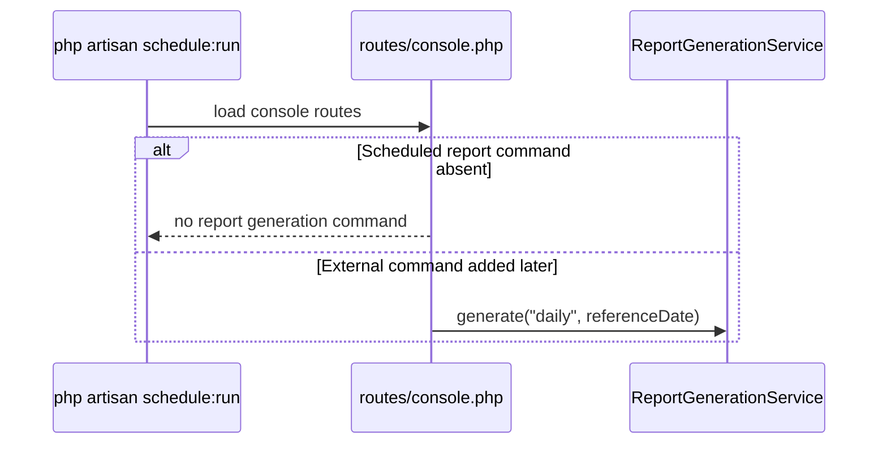

### 4.2 Manual Report Generation by a Department Head

- **Trigger:** A logged-in approved verified user submits the report form.
- **Step-by-step sequence:**
  1. `POST /reports` is routed to `ReportController@store` with `throttle:reports-generate` in `routes/web.php:123-127`.
  2. The form posts `type` and `reference_date` with CSRF in `resources/views/reports/index.blade.php:194-223`.
  3. `StoreReportRequest` validates `type` as daily, weekly, or monthly and `reference_date` as a date in `app/Http/Requests/StoreReportRequest.php:15-20`.
  4. The controller calls `ReportGenerationService::generate()` with the requested type, parsed date, and current user in `app/Http/Controllers/ReportController.php:54-60`.
  5. After generation, it creates in-app notifications for approved Department Heads and an additional critical notification when critical count is above zero in `app/Http/Controllers/ReportController.php:62-80`.
  6. The user is redirected to the report detail page with a success or fallback warning message in `app/Http/Controllers/ReportController.php:82-88`.
- **Inputs and outputs:** Input fields are `type` and `reference_date`; output is a redirect to `reports.show`.
- **External calls:** Groq, Telegram, and optional n8n may be called inside the service.
- **Persistence:** `reports`, `report_ai_summaries`, `user_notifications`, `audit_logs`.
- **Notifications dispatched:** In-app `report.generated`, optional in-app `alert.critical`, Telegram critical alert, and `ReportGenerated` broadcast.
- **Audit log entries:** `report.generated` in `app/Services/Reports/ReportGenerationService.php:77-84`.
- **Failure modes and fallbacks:** Groq failures produce fallback summary; Telegram and n8n failures are logged but do not block report generation.

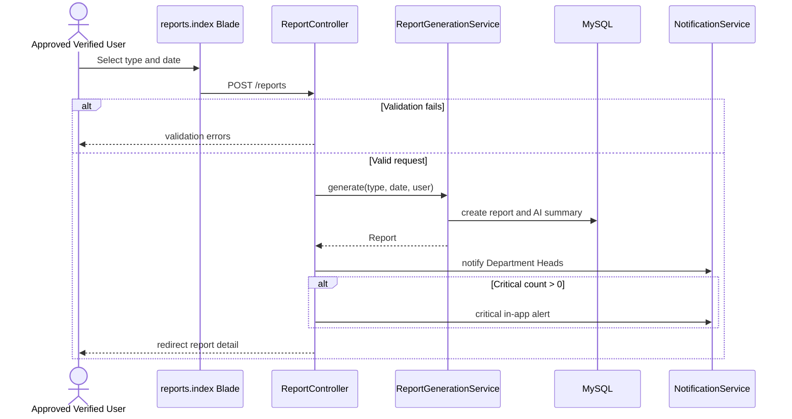

### 4.3 AI Report-Summary Call to Groq

- **Trigger:** Report generation or summary regeneration calls `GroqReportSummaryService::generate()`.
- **Step-by-step sequence:**
  1. The report service calls the AI summary service during report creation in `app/Services/Reports/ReportGenerationService.php:53-54`.
  2. It also calls the same service when a summary is regenerated in `app/Services/Reports/ReportGenerationService.php:93-108`.
  3. The AI service reads Groq base URL, model, and API key from config in `app/Services/Reports/GroqReportSummaryService.php:13-20`.
  4. It sends a POST to `/chat/completions` with model, temperature, system prompt, and user prompt in `app/Services/Reports/GroqReportSummaryService.php:22-40`.
  5. It extracts `choices.0.message.content`, decodes JSON directly or from a JSON-looking substring, and returns structured fields in `app/Services/Reports/GroqReportSummaryService.php:46-61` and `app/Services/Reports/GroqReportSummaryService.php:93-113`.
- **Inputs and outputs:** Input is the report snapshot; output contains provider, model, status, summary text, observations, recommendations, and error message.
- **External calls:** `POST {GROQ_BASE_URL}/chat/completions`, bearer token via `withToken()`, JSON accept header via `acceptJson()`.
- **Persistence:** The returned data is persisted to `report_ai_summaries` and copied into `reports.summary` by `persistSummary()` in `app/Services/Reports/ReportGenerationService.php:111-128`.
- **Notifications dispatched:** None directly.
- **Audit log entries:** Regeneration is audited as `report.summary.regenerated`; initial AI call is not separately audited with prompt/response hashes.
- **Failure modes and fallbacks:** missing config, failed HTTP response, malformed content, and exceptions all call fallback in `app/Services/Reports/GroqReportSummaryService.php:18-20`, `app/Services/Reports/GroqReportSummaryService.php:42-50`, and `app/Services/Reports/GroqReportSummaryService.php:62-64`.

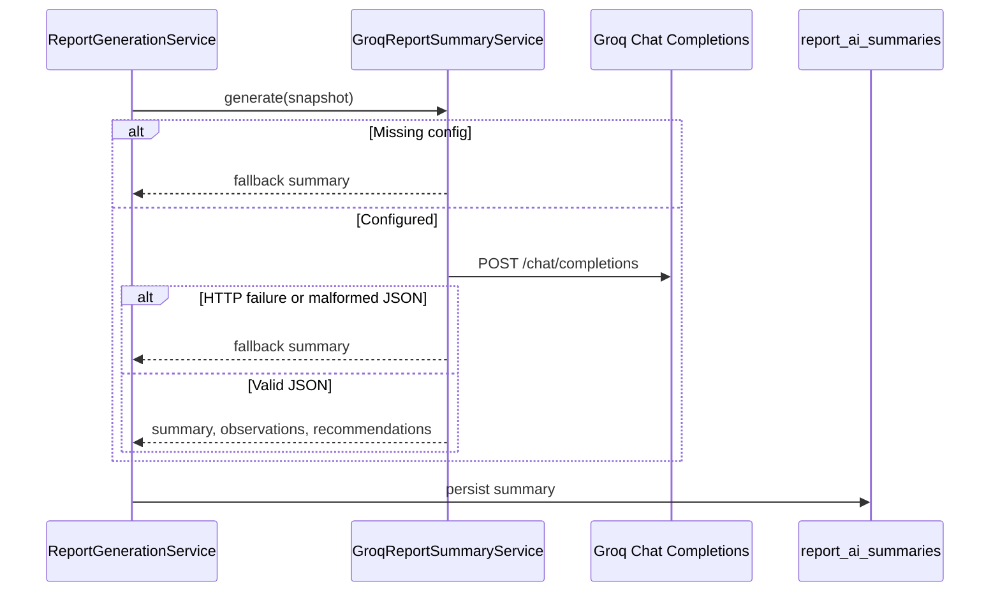

### 4.4 Predictive Maintenance Recommendation Generation

- **Trigger:** Report generation after metrics snapshot calculation.
- **Step-by-step sequence:**
  1. `ReportGenerationService` computes the metrics snapshot in `app/Services/Reports/ReportGenerationService.php:35-36`.
  2. It appends predictive insights from `PredictiveMaintenanceService` in `app/Services/Reports/ReportGenerationService.php:37-38`.
  3. The service loops over metrics and evaluates temperature trend, humidity drift, and critical-status rules in `app/Services/PredictiveMaintenanceService.php:12-51`.
  4. Duplicate title/metric pairs are removed before returning insights in `app/Services/PredictiveMaintenanceService.php:54-57`.
- **Inputs and outputs:** Input is `metrics_snapshot.metrics`; output is an array of insights with severity, title, message, metric, and recommended action.
- **External calls:** None.
- **Persistence:** Insights are embedded in `reports.metrics_snapshot` in `app/Services/Reports/ReportGenerationService.php:39-51`.
- **Notifications dispatched:** None directly.
- **Audit log entries:** Only overall `report.generated` includes the count of predictive insights in `app/Services/Reports/ReportGenerationService.php:77-84`.
- **Failure modes and fallbacks:** Empty or unmatched metrics produce an empty insights array.

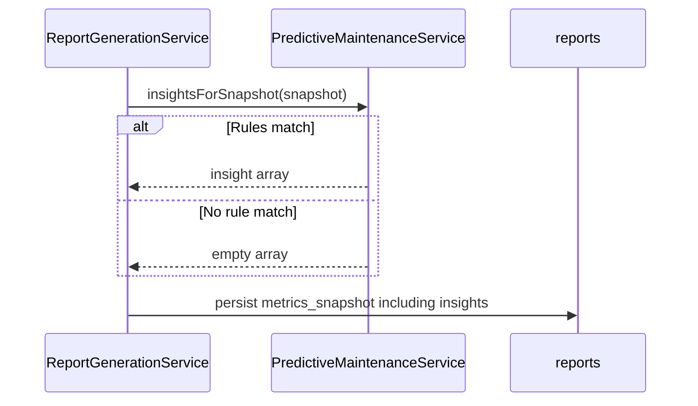

### 4.5 AI Chat Conversation

- **Trigger:** User submits a message from `/ai-chat`.
- **Step-by-step sequence:**
  1. Routes are defined in `routes/web.php:134-136` and protected by the authenticated approved verified group in `routes/web.php:123-158`.
  2. The page loads prior session messages or default assistant message in `app/Http/Controllers/AIChatController.php:28-40`.
  3. The Blade view sends JSON with CSRF token via `fetch()` in `resources/views/ai-chat/index.blade.php:174-219`.
  4. The controller trims and validates `body` between 1 and 1000 characters in `app/Http/Controllers/AIChatController.php:43-55`.
  5. It passes the current message and session history to `AIChatService::reply()` in `app/Http/Controllers/AIChatController.php:58-72`.
  6. The service constructs system prompt, last eight user/assistant history messages, and current user prompt in `app/Services/AIChatService.php:71-95`.
  7. The controller stores the last 20 messages in the session and returns JSON or redirects in `app/Http/Controllers/AIChatController.php:75-92`.
- **Inputs and outputs:** Input is `{ body: string }`; output is user message and assistant message with provider, model, status, and error metadata.
- **External calls:** `POST {GROQ_BASE_URL}/chat/completions` with bearer token and JSON accept header in `app/Services/AIChatService.php:33-42`.
- **Persistence:** Session only; no database table stores AI Chat messages.
- **Notifications dispatched:** None.
- **Audit log entries:** None found for AI Chat calls.
- **Failure modes and fallbacks:** missing Groq config, non-successful response, empty response, and exceptions return deterministic fallback suggestions in `app/Services/AIChatService.php:26-28`, `app/Services/AIChatService.php:44-52`, and `app/Services/AIChatService.php:61-121`.

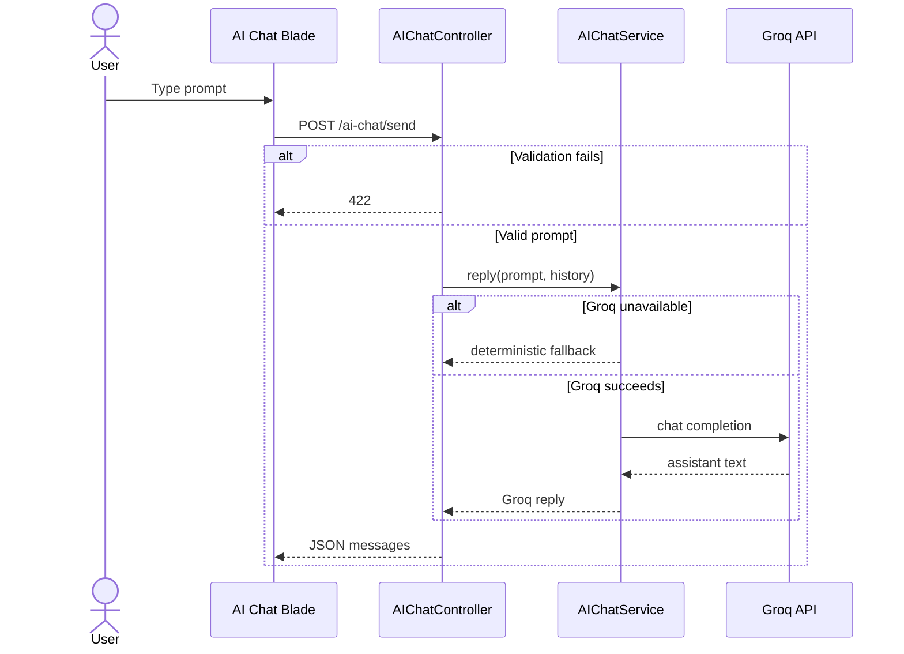

### 4.6 Temperature Prediction via FastAPI Sidecar

- **Trigger:** A Laravel caller would call `TemperaturePredictionService::predict()`. No current caller was found.
- **Step-by-step sequence:**
  1. Laravel service posts to a hard-coded local FastAPI URL in `app/Services/TemperaturePredictionService.php:9-13`.
  2. FastAPI accepts one `temperature` field in `ml_service/predict_api.py:11-13`.
  3. The sidecar loads a committed random-forest model file and predicts class and probability in `ml_service/predict_api.py:8-8` and `ml_service/predict_api.py:20-39`.
  4. Laravel returns fallback values when the response fails in `app/Services/TemperaturePredictionService.php:15-24`.
- **Inputs and outputs:** Laravel sends `{ temperature }`; FastAPI returns temperature, prediction, failure_probability, and risk_level.
- **External calls:** `POST http://127.0.0.1:8001/predict`; no timeout or config key is used in Laravel.
- **Persistence:** None.
- **Notifications dispatched:** None.
- **Audit log entries:** None.
- **Failure modes and fallbacks:** HTTP failure returns prediction null, failure probability null, and risk level unknown.

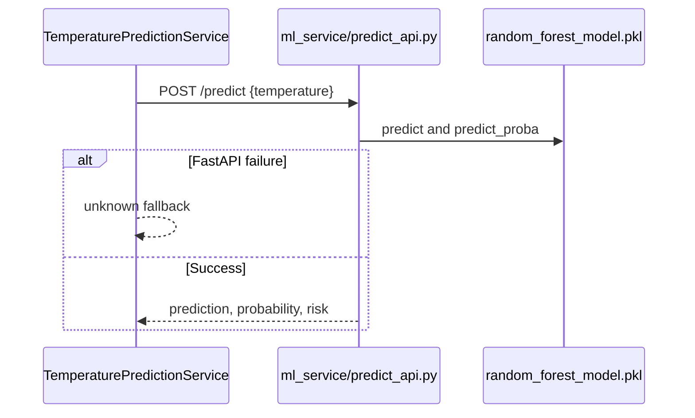

### 4.7 Telegram Account Linking

- **Trigger:** User clicks Connect Telegram in the profile page.
- **Step-by-step sequence:**
  1. Profile Telegram connect route is defined in `routes/web.php:110-115`.
  2. The profile partial shows the connect/reconnect form for approved users in `resources/views/profile/partials/update-profile-information-form.blade.php:58-78`.
  3. `TelegramController::connect()` requires an approved user and configured bot username in `app/Http/Controllers/TelegramController.php:37-49`.
  4. It stores a random 32-character `telegram_link_token` and redirects to `https://t.me/{bot}?start=connect_<token>` in `app/Http/Controllers/TelegramController.php:51-57`.
  5. Telegram posts updates to `/telegram/webhook`, declared in `routes/web.php:65-65`.
  6. The webhook validates `X-Telegram-Bot-Api-Secret-Token` when configured, extracts `/start connect_...`, finds the user, stores `telegram_chat_id`, clears the link token, and confirms by Telegram message in `app/Http/Controllers/TelegramController.php:68-121`.
- **Inputs and outputs:** Input from browser is CSRF-protected POST; input from Telegram includes update text and chat id. Output is redirect to Telegram or `ok` HTTP response.
- **External calls:** Telegram Bot API `sendMessage` through `TelegramService::sendMessage()`.
- **Persistence:** `users.telegram_link_token`, `users.telegram_chat_id`.
- **Notifications dispatched:** Telegram confirmation message.
- **Audit log entries:** None found.
- **Failure modes and fallbacks:** missing bot username returns validation error; missing production webhook secret returns 503; wrong secret returns 403; invalid payload returns an explanatory Telegram message.

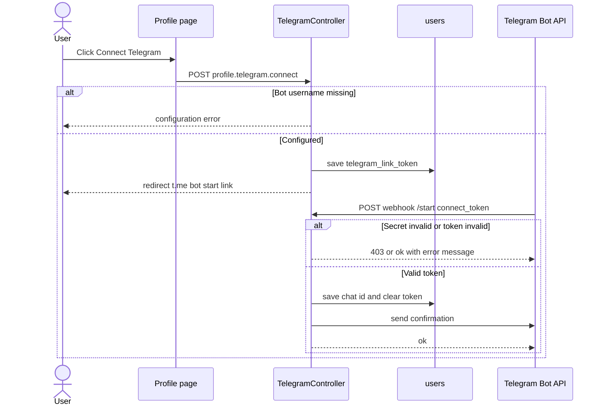

### 4.8 Telegram Outgoing Alert

- **Trigger:** Maintenance assignment, chat mention, or critical report.
- **Step-by-step sequence:**
  1. Maintenance assignment calls Telegram after task creation or reassignment in `app/Services/MaintenanceTaskWorkflowService.php:247-267`.
  2. Chat mentions call Telegram for each mentioned user in `app/Services/ChatWorkspaceService.php:313-329`.
  3. Critical reports call Telegram for approved Department Heads with chat ids in `app/Services/Reports/ReportGenerationService.php:61-75`.
  4. `TelegramService::sendMessage()` checks bot token and chat id, posts to Telegram `sendMessage`, logs connection or failed responses, and does not throw in `app/Services/TelegramService.php:44-73`.
- **Inputs and outputs:** Inputs are chat id and final message text; output is no return value.
- **External calls:** `POST https://api.telegram.org/bot{token}/sendMessage` with `chat_id` and `text`.
- **Persistence:** None by Telegram service itself.
- **Notifications dispatched:** Telegram message.
- **Audit log entries:** None found for Telegram sends.
- **Failure modes and fallbacks:** missing token or chat id silently returns; connection exception and failed HTTP response are logged.

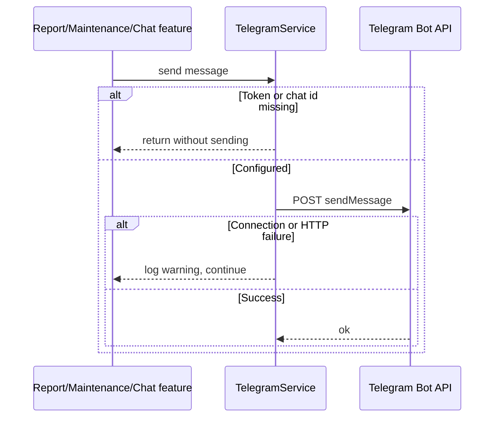

### 4.9 Critical-Report Alert Dispatch

- **Trigger:** Generated report has `overview.critical_count > 0`.
- **Step-by-step sequence:**
  1. `ReportGenerationService` derives critical count from the snapshot after persistence in `app/Services/Reports/ReportGenerationService.php:59-60`.
  2. If critical count is greater than zero, it composes a Telegram message and sends it to approved Department Heads with a linked Telegram chat id in `app/Services/Reports/ReportGenerationService.php:61-75`.
  3. `ReportController` also creates in-app `alert.critical` notifications for approved Department Heads in `app/Http/Controllers/ReportController.php:70-80`.
  4. `NotificationService` stores those notifications and broadcasts `UserNotificationCreated` in `app/Services/NotificationService.php:42-63`.
  5. The topbar and notifications page display `alert.critical` with a red tone in `resources/views/layouts/topbar.blade.php:146-156` and `resources/views/notifications/index.blade.php:53-64`.
- **Inputs and outputs:** Input is report snapshot critical count; output is in-app notification and Telegram message.
- **External calls:** Telegram Bot API only. Critical-report email is not implemented in the inspected code.
- **Persistence:** `user_notifications`; `audit_logs` only contains the general `report.generated` row.
- **Notifications dispatched:** In-app, broadcast, Telegram.
- **Audit log entries:** `report.generated` includes critical count; individual alert dispatches are not audited.
- **Failure modes and fallbacks:** Telegram failures are logged and do not break the report flow. In-app notifications are created only in manual controller flow, not inside the service.

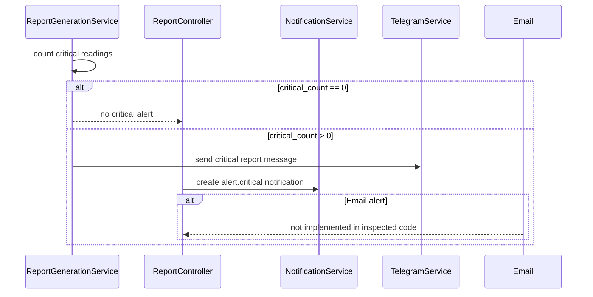

### 4.10 n8n Webhook Dispatch After Report Generation

- **Trigger:** `ReportGenerationService::generate()` always calls `sendN8nReportWebhook()` after audit logging.
- **Step-by-step sequence:**
  1. The service calls `sendN8nReportWebhook($report)` in `app/Services/Reports/ReportGenerationService.php:86-88`.
  2. The webhook URL is read from `services.n8n.report_webhook_url` in `app/Services/Reports/ReportGenerationService.php:131-136`.
  3. If configured, Laravel posts a JSON payload with 10-second timeout in `app/Services/Reports/ReportGenerationService.php:139-140`.
  4. Failed responses and exceptions are logged as warnings in `app/Services/Reports/ReportGenerationService.php:142-156`.
- **Inputs and outputs:** Payload includes report id, type, warning count, critical count, reading count, summary, report URL, and created timestamp in `app/Services/Reports/ReportGenerationService.php:159-172`.
- **External calls:** `POST {N8N_REPORT_WEBHOOK_URL}` with Laravel HTTP client's JSON body.
- **Persistence:** None.
- **Notifications dispatched:** None.
- **Audit log entries:** None specifically for n8n dispatch.
- **Failure modes and fallbacks:** Missing URL silently disables the integration; failed calls are logged and do not affect report generation.

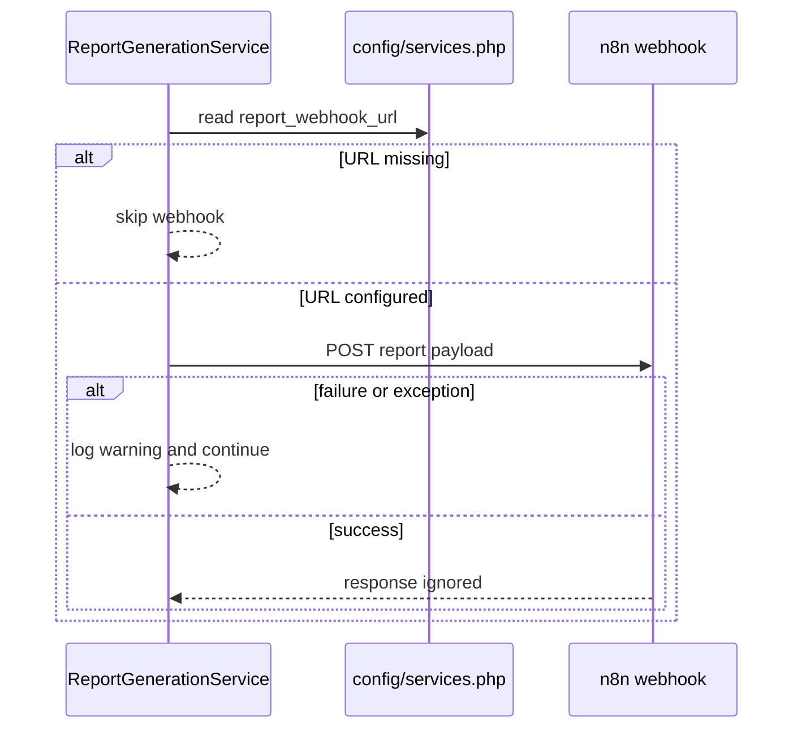

## 5. AI Integration - Groq Deep Dive

### Report Summary Service

- **Endpoint and model:** Groq base URL and model are read from `services.groq.base_url` and `services.groq.model` in `config/services.php:58-63`; defaults are OpenAI-compatible Groq URL and `llama-3.3-70b-versatile`.
- **HTTP client configuration:** The service uses `Http::baseUrl($baseUrl)`, bearer token with `withToken($apiKey)`, JSON accept header, 20-second timeout, and POST `/chat/completions` in `app/Services/Reports/GroqReportSummaryService.php:22-40`. No retry call is present in that chain.
- **System prompt:** The prompt instructs the model to produce concise operational reports, use only provided numbers, and return valid JSON with summary, observations, and recommendations. It is defined in `app/Services/Reports/GroqReportSummaryService.php:30-38`.
- **User-message construction:** The prompt injects report type, period start/end, overview, metrics, and the first five anomalies through `promptPayload()` in `app/Services/Reports/GroqReportSummaryService.php:67-90`.
- **Response parsing:** The code reads `choices.0.message.content`, tries direct JSON decoding, then extracts a JSON-looking object with regex before decoding again in `app/Services/Reports/GroqReportSummaryService.php:46-61` and `app/Services/Reports/GroqReportSummaryService.php:93-113`.
- **Fallback strategy:** If Groq is unavailable or malformed, the fallback sorts risk metrics by critical, warning, and anomaly counts; builds deterministic observations; creates metric-priority recommendations; and summarizes the period counts in `app/Services/Reports/GroqReportSummaryService.php:115-170`.
- **Token budget and cost considerations:** No `max_tokens` value is set in the request body at `app/Services/Reports/GroqReportSummaryService.php:27-40`.
- **Audit logging of AI calls:** Summary regeneration is audited with provider, model, and status in `app/Services/Reports/ReportGenerationService.php:100-105`. Initial Groq report calls are not separately audited with prompt hash or response hash.

### AI Chat Service

- **Endpoint and model:** AI Chat uses the same Groq config values in `app/Services/AIChatService.php:21-28`.
- **HTTP client configuration:** It uses base URL, bearer token, JSON accept header, 20-second timeout, and POST `/chat/completions` in `app/Services/AIChatService.php:33-42`. No retry call is present.
- **System prompt:** The system prompt frames the assistant as a server-room operations helper focused on reports, server health, maintenance, monitoring, power, cooling, and safe next actions in `app/Services/AIChatService.php:84-88`.
- **Conversation history:** The service filters session messages to user/assistant roles, keeps the last eight, maps them to Groq message format, appends the current user prompt, and returns the final message list in `app/Services/AIChatService.php:71-95`.
- **Response handling:** It returns success when `choices.0.message.content` is non-empty; otherwise it falls back in `app/Services/AIChatService.php:44-60`.
- **Fallback strategy:** Fallback suggestions are selected by keyword categories for temperature/heat, power/UPS, maintenance/task, report/summary, or generic dashboard review in `app/Services/AIChatService.php:97-121`.
- **Persistence:** AI Chat history is stored only in session, capped to the last 20 messages in `app/Http/Controllers/AIChatController.php:75-80`.
- **Audit logging:** No audit log entry is written for AI Chat prompts or responses.

## 6. Predictive Maintenance - Rule Catalogue

| Rule ID | Trigger Condition | Threshold | Recommendation Generated | File:line |
|---|---|---|---|---|
| PM-01 | Metric key is `temperature` and trend is `rising`. | Trend produced by calculator when end-window average exceeds start-window average by more than 0.75. | Cooling inspection within the reporting context; severity mirrors critical status otherwise warning. | `app/Services/PredictiveMaintenanceService.php:19-27`; `app/Services/Reports/ReportMetricsCalculator.php:133-154` |
| PM-02 | Metric key is `humidity` and latest status is not Stable or trend is not stable. | Humidity status comes from provider thresholds and calculator classification. | Check environmental controls and sensor placement. | `app/Services/PredictiveMaintenanceService.php:29-37`; `app/Services/Reports/DatabaseSensorDataProvider.php:24-35` |
| PM-03 | Any metric latest status is `Critical` and average value is greater than zero. | Critical thresholds come from each metric definition. | Escalate to urgent maintenance. | `app/Services/PredictiveMaintenanceService.php:39-51`; `app/Services/Reports/DatabaseSensorDataProvider.php:13-87` |

## 7. FastAPI Temperature Prediction Sidecar

- **Endpoint URL:** Laravel uses a hard-coded `http://127.0.0.1:8001/predict` endpoint in `app/Services/TemperaturePredictionService.php:9-13`. No `ML_SERVICE_URL` config key was found in `config/services.php:58-79`.
- **Request schema:** The FastAPI temperature sidecar accepts one `temperature: float` field in `ml_service/predict_api.py:11-13`.
- **Response schema:** It returns temperature, prediction, failure_probability, and risk_level in `ml_service/predict_api.py:34-39`.
- **Algorithm:** The temperature sidecar loads `model/random_forest_model.pkl`, uses `predict()` and `predict_proba()`, and the training script uses `RandomForestClassifier(n_estimators=100, random_state=42)` in `ml_service/predict_api.py:8-8`, `ml_service/predict_api.py:20-39`, and `ml_service/train_model.py:21-36`.
- **Training data source:** The training script loads `server_failure_dataset.csv` and uses only `temperature` as the feature and `failed` as the target in `ml_service/train_model.py:7-18`.
- **Laravel failure handling:** When the response fails, Laravel returns null prediction, null probability, and `risk_level = unknown` in `app/Services/TemperaturePredictionService.php:15-24`.
- **User-facing wiring:** No current Laravel caller references `TemperaturePredictionService` except the service itself; it is an extension point, not currently exposed in the report UI.
- **Separate Isolation Forest sidecar:** A separate `../ai-service` FastAPI app accepts `temperature` and `power_w` in `../ai-service/main.py:10-28`, uses `IsolationForest` in `../ai-service/model.py:21-27`, and applies safety rules for critical and warning outputs in `../ai-service/model.py:40-78`.

## 8. Telegram Integration - Deep Dive

### Account-Linking Flow

The profile page shows a Telegram alert panel and connect/reconnect button for approved users in `resources/views/profile/partials/update-profile-information-form.blade.php:58-78`. `TelegramController::connect()` checks approval, checks bot username, stores a random `telegram_link_token`, and redirects to a `t.me` deep link in `app/Http/Controllers/TelegramController.php:37-57`. The webhook then validates `/start connect_<token>`, finds the matching user, stores `telegram_chat_id`, clears the link token, and confirms the connection in `app/Http/Controllers/TelegramController.php:81-121`.

### Webhook Security

The webhook reads `X-Telegram-Bot-Api-Secret-Token`, returns 503 in production if a secret is not configured, and uses `hash_equals()` when comparing the configured secret to the provided header in `app/Http/Controllers/TelegramController.php:70-79`.

### Outgoing Message Templates

- Maintenance assignment messages identify a new maintenance task, server room, priority, and sender in `app/Services/TelegramService.php:75-91`.
- Chat mention messages identify that the user was mentioned, the sender, and a shortened message preview in `app/Services/TelegramService.php:93-108`.
- Critical-report messages include the report title, critical count, and generation timestamp in `app/Services/Reports/ReportGenerationService.php:61-75`.
- Telegram connection success and invalid-link guidance are sent from the webhook in `app/Http/Controllers/TelegramController.php:94-118`.

### Rate Limiting and Retry Behaviour

No explicit route throttle is applied to `POST /telegram/webhook` in `routes/web.php:65-65`. `TelegramService` uses a 3-second connect timeout and 5-second timeout, but no retry call is present in `app/Services/TelegramService.php:52-73`.

### Edge Cases

Users without `telegram_chat_id` do not receive assignment or mention Telegram messages because both helper methods return early in `app/Services/TelegramService.php:75-108`. Missing bot token or empty chat id causes `sendMessage()` to return early in `app/Services/TelegramService.php:44-50`. Blocked bots, revoked chats, or API rejections are logged as warnings without throwing in `app/Services/TelegramService.php:66-72`.

## 9. n8n Automation

- **Webhook endpoint config key:** `services.n8n.report_webhook_url`, sourced from `N8N_REPORT_WEBHOOK_URL`, is defined in `config/services.php:76-79`.
- **Payload schema:** `report_id`, `type`, `warnings`, `critical`, `readings`, `summary`, `report_url`, and `created_at` are sent in `app/Services/Reports/ReportGenerationService.php:159-172`.
- **Trigger condition:** `sendN8nReportWebhook()` is called after every successful report generation in `app/Services/Reports/ReportGenerationService.php:86-88`; it silently returns when the URL is empty in `app/Services/Reports/ReportGenerationService.php:131-137`.
- **HTTP method, headers, body:** Laravel uses `Http::timeout(10)->post($webhookUrl, payload)` in `app/Services/Reports/ReportGenerationService.php:139-140`; no custom headers or signature are set.
- **Response handling:** Failed status logs warning details; successful responses are not consumed in `app/Services/Reports/ReportGenerationService.php:142-149`.
- **Failure handling:** Exceptions are caught and logged, and report generation continues in `app/Services/Reports/ReportGenerationService.php:150-156`.
- **n8n exports:** No n8n workflow JSON file was found during repository file discovery; TO VERIFY whether the workflow canvas exists outside the repository.

## 10. Report Pipeline - Internal Architecture

### Data Providers

`AppServiceProvider` binds `SensorDataProvider` to `DatabaseSensorDataProvider` in `app/Providers/AppServiceProvider.php:45-50`. The provider reads `SensorReading` rows by `recorded_at` and `ServerMetric` rows by `created_at` for the resolved period in `app/Services/Reports/DatabaseSensorDataProvider.php:89-109`.

### Metrics Calculator

The calculator computes reading count, average, min, max, latest value, latest status, warning count, critical count, anomaly count, and trend direction for each metric in `app/Services/Reports/ReportMetricsCalculator.php:17-109`.

### Anomaly Detection Rules

Each reading is classified as Critical, Warning, or Stable based on `critical_above`, `warning_above`, `critical_below`, and `warning_below` thresholds in `app/Services/Reports/ReportMetricsCalculator.php:112-131`. Spike anomalies are added when the absolute delta from the previous reading exceeds the metric's `spike_delta` in `app/Services/Reports/ReportMetricsCalculator.php:41-55`.

### Thresholds

Environmental thresholds are defined in `app/Services/Reports/DatabaseSensorDataProvider.php:13-35`: temperature warning above 25, critical above 30, spike delta 2; humidity warning above 60, critical above 70, warning below 35, critical below 30, spike delta 6. Server metric thresholds are defined in `app/Services/Reports/DatabaseSensorDataProvider.php:38-87`, including CPU/RAM/disk warning above 80 and critical above 90, server temperature warning above 70 and critical above 85, and network throughput spike delta 200.

### Snapshot Structure

The snapshot returned by the calculator includes `type`, `source`, `period_start`, `period_end`, `overview`, `metrics`, and top anomalies in `app/Services/Reports/ReportMetricsCalculator.php:92-109`. `ReportGenerationService` then appends `predictive_insights` before persistence in `app/Services/Reports/ReportGenerationService.php:35-38`.

### Persistence

Within a transaction, `ReportGenerationService` creates a report with type, source, title, period start/end, status, generator id, generated timestamp, metrics snapshot, and anomalies in `app/Services/Reports/ReportGenerationService.php:39-51`. It generates a summary, persists it as a related `ReportAiSummary`, and copies `summary_text` to `reports.summary` in `app/Services/Reports/ReportGenerationService.php:53-57` and `app/Services/Reports/ReportGenerationService.php:111-128`.

### Idempotency

No unique constraint prevents generating multiple reports for the same type and period; the `reports` migration only indexes `type` and `generated_at` in `database/migrations/2026_03_12_110000_create_reports_table.php:15-31`. Therefore, generating the same period twice creates multiple report rows.

## 11. Data Model - Sprint 4 Tables

### reports

- **Migration:** `database/migrations/2026_03_12_110000_create_reports_table.php:15-31`.
- **Columns:** `id`, `type`, `source` default `demo`, `title`, `period_start`, `period_end`, `status` default `generated`, nullable `generated_by` foreign key null-on-delete, nullable `generated_at`, nullable `summary`, `metrics_snapshot` JSON, nullable `anomalies` JSON, timestamps.
- **Indexes:** composite `type`, `generated_at` in `database/migrations/2026_03_12_110000_create_reports_table.php:30-30`.
- **Relationships:** `generatedBy`, `aiSummaries`, and `latestAiSummary` in `app/Models/Report.php:37-50`.
- **Lifecycle:** Created by `ReportGenerationService::generate()` and displayed by report views.

### report_ai_summaries

- **Migration:** `database/migrations/2026_03_12_110100_create_report_ai_summaries_table.php:15-29`.
- **Columns:** `id`, `report_id` cascade foreign key, nullable `provider`, nullable `model`, `status` default fallback, `summary_text`, nullable JSON `observations`, nullable JSON `recommendations`, nullable `error_message`, nullable `generated_at`, timestamps.
- **Indexes:** composite `report_id`, `generated_at`.
- **Relationships:** belongs to Report in `app/Models/ReportAiSummary.php:31-34`.
- **Lifecycle:** Created during report generation and summary regeneration.

### users Telegram Columns

- **Migrations:** `database/migrations/2026_04_06_020722_add_telegram_chat_id_to_users_table.php:11-14` and idempotent follow-up `database/migrations/2026_04_06_021833_add_missing_telegram_columns_to_users_table.php:11-21`.
- **Columns:** nullable `telegram_chat_id`, nullable `telegram_link_token`.
- **Model protection:** Both fields are fillable but hidden from serialization in `app/Models/User.php:54-78`.
- **Lifecycle:** Token is created during connect flow, replaced by chat id during webhook linking, and cleared after success.

### user_notifications

- **Migration:** `database/migrations/2026_04_06_080000_create_user_notifications_table.php:11-24`.
- **Columns:** `id`, `user_id` cascade foreign key, `type`, `title`, nullable `body`, nullable `url`, nullable JSON `data`, nullable `read_at`, timestamps.
- **Indexes:** `user_id`, `read_at` and `user_id`, `created_at`.
- **Relationships:** belongs to User in `app/Models/UserNotification.php:43-48`; User has many notifications in `app/Models/User.php:229-234`.
- **Lifecycle:** Created by `NotificationService`, displayed in topbar and notification inbox, and marked read by `NotificationController`.

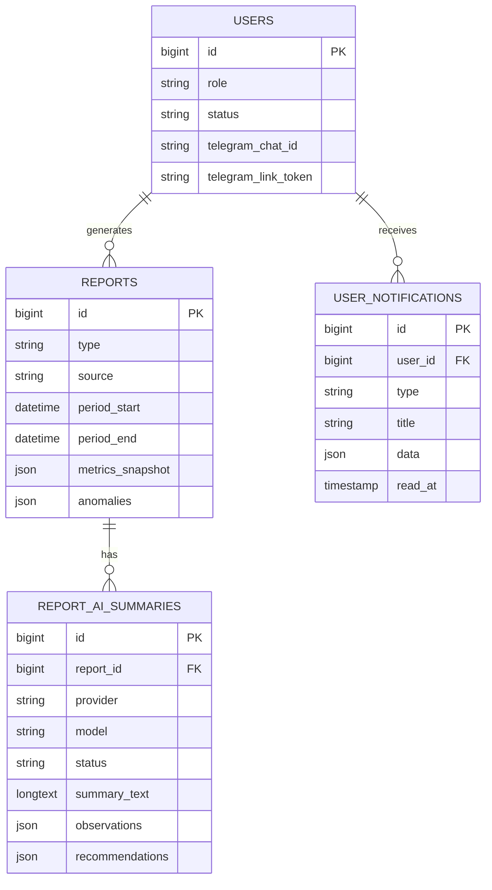

## 12. Notifications and Emails Generated by Sprint 4

| Class | Channels (`via()`) | Trigger | Recipient | Subject (paraphrased) | File:line |
|---|---|---|---|---|---|
| `UserNotificationCreated` event | private broadcast | `NotificationService::notifyUser()` after in-app notification row is created | Target user | Not email; realtime notification payload | `app/Services/NotificationService.php:42-63`; `app/Events/UserNotificationCreated.php:13-50` |
| In-app `report.generated` notification | database row plus broadcast event | Manual report generation | Approved Department Heads | Report generated | `app/Http/Controllers/ReportController.php:62-68`; `app/Services/NotificationService.php:89-103` |
| In-app `alert.critical` notification | database row plus broadcast event | Manual report generation with critical count > 0 | Approved Department Heads | Critical conditions detected | `app/Http/Controllers/ReportController.php:70-80`; `app/Services/NotificationService.php:89-103` |
| Telegram critical report message | Telegram Bot API | Report generation with critical count > 0 | Approved Department Heads with `telegram_chat_id` | Critical report alert | `app/Services/Reports/ReportGenerationService.php:61-75` |
| Telegram maintenance assignment | Telegram Bot API | Maintenance task assignment | Assigned user with `telegram_chat_id` | New maintenance task | `app/Services/MaintenanceTaskWorkflowService.php:247-267`; `app/Services/TelegramService.php:75-91` |
| Telegram chat mention | Telegram Bot API | Team chat mention | Mentioned user with `telegram_chat_id` | Chat mention | `app/Services/ChatWorkspaceService.php:313-329`; `app/Services/TelegramService.php:93-108` |
| Critical-report alert email | Not found | Intended by prompt but not implemented in inspected code | TO VERIFY | TO VERIFY | `config/mail.php:19-52` shows SMTP capability; no report mail class found |
| Weekly-report summary email | Not found | Intended by prompt but not implemented in inspected code | TO VERIFY | TO VERIFY | `config/mail.php:19-52` shows SMTP capability; no report mail class found |

### SMTP Delivery

All email notifications in this Laravel project are delivered through Laravel Mail and Notifications using the configured mailer in `config/mail.php:19-52`. The deployment fact supplied for this audit states that production SMTP is Brevo, formerly Sendinblue. No Brevo SDK or Brevo HTTP API integration was found for this sprint. In the inspected Sprint 4 code, critical-report and weekly-report email notification classes were not found; if they are added later, they will use the same provider-agnostic SMTP configuration unless implemented otherwise.

## 13. Audit Logging in Sprint 4

| Action key | When | Writer |
|---|---|---|
| `report.generated` | After a report is generated; metadata includes type, source, critical count, warning count, reading count, and predictive insight count. | `app/Services/Reports/ReportGenerationService.php:77-84` |
| `report.summary.regenerated` | After a summary regeneration request creates a new summary record; metadata includes summary id, provider, model, and status. | `app/Services/Reports/ReportGenerationService.php:100-105` |

Audit gaps:

- 🟡 Initial Groq report-summary calls are not audited with prompt hash, response hash, latency, or status beyond the eventual `report.generated` metadata.
- 🟡 AI Chat calls are not audited in `app/Http/Controllers/AIChatController.php:43-92` or `app/Services/AIChatService.php:19-64`.
- 🟡 Telegram outgoing sends are not audited in `app/Services/TelegramService.php:44-108`.
- 🟡 n8n webhook dispatch attempts are not audited in `app/Services/Reports/ReportGenerationService.php:131-156`.
- 🟡 Critical in-app notification fan-out is not separately audited in `app/Http/Controllers/ReportController.php:70-80`.

## 14. Configuration and Environment Variables

| Key | Default | Used in (file:line) | Purpose |
|---|---|---|---|
| `GROQ_API_KEY` | empty in example | `config/services.php:58-63`; `.env.example:141-143` | Bearer token for Groq report summaries and AI Chat. |
| `GROQ_BASE_URL` | `https://api.groq.com/openai/v1` | `config/services.php:60-62`; `.env.example:141-143` | OpenAI-compatible API base URL. |
| `GROQ_MODEL` | `llama-3.3-70b-versatile` | `config/services.php:60-62`; `.env.example:141-143` | Model used by report summary and AI Chat. |
| `TELEGRAM_BOT_TOKEN` | empty in example | `config/services.php:69-74`; `.env.example:146-148` | Telegram Bot API token used to call `sendMessage`. |
| `TELEGRAM_BOT_USERNAME` | empty in example | `config/services.php:69-74`; `.env.example:146-148` | Bot username used to build `t.me` deep links. |
| `TELEGRAM_WEBHOOK_SECRET` | empty in example | `config/services.php:69-74`; `.env.example:146-148` | Secret header expected from Telegram webhook requests. |
| `N8N_REPORT_WEBHOOK_URL` | no default | `config/services.php:76-79` | Optional n8n webhook URL for report automation. This key was not present in the inspected `.env.example:141-148` service-key block. |
| `ML_SERVICE_URL` | Not defined | `app/Services/TemperaturePredictionService.php:9-13` | No config key exists; FastAPI URL is hard-coded. |
| `QUEUE_CONNECTION` | `database` in example | `config/queue.php:16-44`; `.env.example:61-68` | Queue configuration exists, but Sprint 4 AI/report calls are synchronous in inspected code. |
| `MAIL_*` | log/local placeholders | `config/mail.php:19-52`; `.env.example:119-128` | SMTP delivery. In production, the audit prompt states these are configured for Brevo SMTP. |

## 15. Frontend Pages - Sprint 4 UI Inventory

| Route name | Blade file | Purpose | Form fields (main) | CSRF | Echo channels subscribed |
|---|---|---|---|---|---|
| `reports.index` | `resources/views/reports/index.blade.php` | Report list, filter tabs, stats, and manual generation form. | `type`, `reference_date` | Yes, `resources/views/reports/index.blade.php:194-196` | Department Heads subscribe to `ops.admin` globally in `resources/js/bootstrap.js:69-77`. |
| `reports.show` | `resources/views/reports/show.blade.php` | Report detail, AI summary, metrics, anomalies, predictive insights, and summary history. | Regenerate summary button | Yes, `resources/views/reports/show.blade.php:57-65` | Same global `ops.admin` subscription for Department Heads. |
| `ai-chat.index` | `resources/views/ai-chat/index.blade.php` | AI Chat assistant page. | `body` | Yes, `resources/views/ai-chat/index.blade.php:93-95`; JS sends `X-CSRF-TOKEN` in `resources/views/ai-chat/index.blade.php:185-195` | No Echo subscription specific to AI Chat. |
| `profile.edit` | `resources/views/profile/partials/update-profile-information-form.blade.php` | Profile page includes Telegram connect/reconnect panel. | Telegram connect form only posts CSRF | Yes, `resources/views/profile/partials/update-profile-information-form.blade.php:70-76` | User notification subscription globally in `resources/js/bootstrap.js:47-50`. |
| `notifications.index` | `resources/views/notifications/index.blade.php` | Notification inbox for report, critical, maintenance, chat, and user notifications. | Mark read/all forms | Yes, `resources/views/notifications/index.blade.php:27-35` and `resources/views/notifications/index.blade.php:131-139` | User notification subscription globally in `resources/js/bootstrap.js:47-50`. |
| Global topbar | `resources/views/layouts/topbar.blade.php` | Notification dropdown and unread badge. | Mark all/read forms | Yes, `resources/views/layouts/topbar.blade.php:133-141` and `resources/views/layouts/topbar.blade.php:159-163` | Updated by `user-notification-created` event listener in `resources/js/app.js:183-243`. |

## 16. Test Coverage

### Sprint 4 Related Tests

| Path | Test class | Test method | What it asserts |
|---|---|---|---|
| `tests/Feature/Reports/ReportGenerationTest.php` | `ReportGenerationTest` | `test_authenticated_user_can_generate_a_report` | Authenticated user can post report request, receive redirect, and report plus AI summary are created. `tests/Feature/Reports/ReportGenerationTest.php:17-38` |
| `tests/Feature/Reports/ReportGenerationTest.php` | `ReportGenerationTest` | `test_report_generation_still_succeeds_when_telegram_is_unreachable` | Telegram connection failure is faked and report generation still succeeds. `tests/Feature/Reports/ReportGenerationTest.php:40-71` |
| `tests/Feature/Reports/ReportGenerationTest.php` | `ReportGenerationTest` | `test_reports_include_real_server_metrics` | Report source includes server metrics and the snapshot contains `server_cpu_percent`. `tests/Feature/Reports/ReportGenerationTest.php:73-101` |
| `tests/Feature/Reports/ReportGenerationTest.php` | `ReportGenerationTest` | `test_report_detail_page_is_displayed` | Report detail page shows title, executive summary, and computed statistics. `tests/Feature/Reports/ReportGenerationTest.php:103-117` |
| `tests/Feature/Reports/ReportGenerationTest.php` | `ReportGenerationTest` | `test_ai_summary_can_be_regenerated` | Summary regeneration adds one AI summary version. `tests/Feature/Reports/ReportGenerationTest.php:119-134` |
| `tests/Feature/AIChat/AIChatTest.php` | `AIChatTest` | `test_authenticated_user_can_view_ai_chat_page` | AI Chat page renders expected text. `tests/Feature/AIChat/AIChatTest.php:14-24` |
| `tests/Feature/AIChat/AIChatTest.php` | `AIChatTest` | `test_authenticated_user_can_send_message_and_receive_groq_response` | Groq API is mocked with `Http::fake`, JSON response is returned, and provider is `groq`. `tests/Feature/AIChat/AIChatTest.php:26-61` |
| `tests/Feature/AIChat/AIChatTest.php` | `AIChatTest` | `test_ai_chat_falls_back_when_groq_is_not_configured` | Missing Groq key returns fallback provider and fallback text. `tests/Feature/AIChat/AIChatTest.php:63-83` |
| `tests/Feature/Chat/ChatTest.php` | `ChatTest` | `test_tagged_users_receive_platform_and_telegram_notifications` | Chat mentions create in-app notification and mocked Telegram API send. `tests/Feature/Chat/ChatTest.php:127-169` |
| `tests/Feature/Maintenance/MaintenanceTaskModuleTest.php` | `MaintenanceTaskModuleTest` | `test_department_head_can_create_task_and_assignment_notifications_are_sent` | Maintenance assignment creates in-app notification and mocked Telegram send. `tests/Feature/Maintenance/MaintenanceTaskModuleTest.php:17-66` |
| `tests/Feature/ProfileTest.php` | `ProfileTest` | `test_approved_staff_can_start_the_telegram_connection_flow` | Approved Staff can start Telegram linking and receive a `t.me` redirect. `tests/Feature/ProfileTest.php:68-85` |
| `tests/Feature/ProfileTest.php` | `ProfileTest` | `test_telegram_link_fields_are_hidden_from_default_user_serialization` | Telegram chat/link fields are hidden in user serialization. `tests/Feature/ProfileTest.php:141-152` |

### Coverage Matrix

| Feature | Has test? | Test file | Notes |
|---|---|---|---|
| Manual report generation | Yes | `tests/Feature/Reports/ReportGenerationTest.php:17-38` | Covered. |
| Scheduled report generation | 🟡 Not tested | None | No scheduler implementation found. |
| Report metrics include server data | Yes | `tests/Feature/Reports/ReportGenerationTest.php:73-101` | Covered. |
| Groq report-summary call | 🟡 Partial | None direct | Report tests rely on fallback unless config is set; no direct Groq report mock found. |
| AI summary regeneration | Yes | `tests/Feature/Reports/ReportGenerationTest.php:119-134` | Covered. |
| AI Chat Groq call | Yes | `tests/Feature/AIChat/AIChatTest.php:26-61` | Groq is mocked with `Http::fake`, not actually invoked. |
| AI Chat fallback | Yes | `tests/Feature/AIChat/AIChatTest.php:63-83` | Covered. |
| Predictive maintenance rules | 🟡 Not tested directly | None | Display path is indirectly exercised by report generation. |
| Temperature prediction sidecar | 🟡 Not tested | None | No caller found. |
| Telegram profile linking start | Yes | `tests/Feature/ProfileTest.php:68-85` | Start flow covered. |
| Telegram webhook completion | 🟡 Not tested | None | No webhook test found. |
| Telegram maintenance assignment | Yes | `tests/Feature/Maintenance/MaintenanceTaskModuleTest.php:17-66` | Telegram API mocked. |
| Telegram chat mention | Yes | `tests/Feature/Chat/ChatTest.php:127-169` | Telegram API mocked. |
| Telegram critical report alert | 🟡 Partial | `tests/Feature/Reports/ReportGenerationTest.php:40-71` | Failure tolerance covered; message content not asserted. |
| n8n webhook | 🟡 Not tested | None | No n8n HTTP fake/assertion found. |
| Critical-report email | 🟡 Not tested | None | No implementation found. |

## 17. Security Review - Sprint 4 Only

### 🟠 High - Manual Report Generation Is Not Department Head-Only

Evidence: report routes are in the general authenticated approved verified group in `routes/web.php:123-128`, and `StoreReportRequest::authorize()` only requires a logged-in user in `app/Http/Requests/StoreReportRequest.php:10-13`. Risk: Staff can generate reports and trigger Groq calls, Telegram critical alerts, n8n webhooks, and report broadcasts. Recommended fix: move `reports.store` and summary regeneration behind `department.head` or add policy checks.

### 🟠 High - n8n Webhook URL Is Logged in Full on Failure

Evidence: webhook failure logs include `webhook_url` in `app/Services/Reports/ReportGenerationService.php:142-156`. Risk: webhook URLs often embed secret paths or tokens, so logs could expose automation credentials. Recommended fix: redact or hash the URL before logging.

### 🟡 Medium - n8n Webhook Is Unsigned

Evidence: the code posts the payload with no custom signature header in `app/Services/Reports/ReportGenerationService.php:139-140`. Risk: n8n cannot verify that the payload came from Laravel if the URL is leaked. Recommended fix: add an HMAC signature header and timestamp.

### 🟡 Medium - AI Chat Is Cost-Limited but Not Audited

Evidence: AI Chat has a 20-per-minute limiter in `app/Providers/AppServiceProvider.php:73-76`, but no audit call appears in `app/Http/Controllers/AIChatController.php:43-92` or `app/Services/AIChatService.php:19-64`. Risk: costly or abusive prompts are harder to investigate. Recommended fix: audit prompt hash, response hash, provider, model, status, and latency.

### 🟡 Medium - Prompt Injection Risk Is Managed Only by System Prompt

Evidence: user input is appended directly as a Groq user message in `app/Services/AIChatService.php:90-93`. Risk: users can ask the model to ignore instructions, and the application has no additional safety layer. Recommended fix: add prompt governance and avoid adding sensitive application context to user-controllable prompts.

### 🟡 Medium - Telegram Webhook Has No Route Throttle

Evidence: `POST /telegram/webhook` is public in `routes/web.php:65-65`; it validates a secret when configured in `app/Http/Controllers/TelegramController.php:70-79`, but no route throttle is attached. Risk: unauthenticated request floods can consume application resources. Recommended fix: add a webhook-specific throttle.

### 🟡 Medium - Critical Report Email Alerts Are Not Implemented

Evidence: critical in-app notifications are created in `app/Http/Controllers/ReportController.php:70-80`, Telegram critical alerts are sent in `app/Services/Reports/ReportGenerationService.php:61-75`, but no Sprint 4 mail/notification class for critical report email was found. Risk: email escalation expected by the report narrative does not happen. Recommended fix: implement and test a report-critical mail notification through Laravel notifications.

### 🟡 Medium - ML Sidecar URL Is Hard-Coded and Has No Timeout

Evidence: `TemperaturePredictionService` posts to `http://127.0.0.1:8001/predict` without config or timeout in `app/Services/TemperaturePredictionService.php:9-13`. Risk: deployments cannot configure the sidecar cleanly and requests may block longer than intended. Recommended fix: use `ML_SERVICE_URL` and set timeout/retry policy.

### 🟢 Low - Groq Report Prompts Avoid Raw Dataset Leakage

Evidence: `promptPayload()` sends overview, computed metrics, and at most five anomalies, not the full raw dataset in `app/Services/Reports/GroqReportSummaryService.php:67-90`. Residual risk: anomaly records still include operational metric names and timestamps. Recommended fix: continue avoiding credentials, IPs, and personal data in prompts.

### 🟢 Low - Telegram Secret Comparison Is Timing-Safe

Evidence: `hash_equals()` is used for Telegram webhook secret comparison in `app/Http/Controllers/TelegramController.php:70-79`. Recommended fix: keep this pattern and require the secret in all environments that expose the webhook publicly.

### ℹ️ Info - Groq and Telegram APIs Are Mocked in Key Tests

Evidence: AI Chat uses `Http::fake()` in `tests/Feature/AIChat/AIChatTest.php:34-44`; report Telegram failure is faked in `tests/Feature/Reports/ReportGenerationTest.php:40-44`; maintenance and chat Telegram tests also fake HTTP in `tests/Feature/Maintenance/MaintenanceTaskModuleTest.php:17-66` and `tests/Feature/Chat/ChatTest.php:127-169`. This prevents real external calls during tests.

## 18. Sprint Backlog (Internship-Report Format)

| Field | Content |
|---|---|
| Duration | TO VERIFY from the project Gantt. Existing plan file labels this feature set as Sprint 5, while this audit prompt labels it Sprint 4. |
| Main Objective | Transform stored telemetry and operational records into reports, AI summaries, predictive recommendations, alerts, and external automation hooks. |
| Tasks Completed | Report routes and controller in `routes/web.php:123-128` and `app/Http/Controllers/ReportController.php:22-111`; metrics provider and calculator in `app/Services/Reports/DatabaseSensorDataProvider.php:89-200` and `app/Services/Reports/ReportMetricsCalculator.php:9-155`; Groq report summaries in `app/Services/Reports/GroqReportSummaryService.php:11-170`; predictive insights in `app/Services/PredictiveMaintenanceService.php:7-58`; AI Chat in `app/Http/Controllers/AIChatController.php:28-92` and `app/Services/AIChatService.php:19-121`; Telegram linking in `app/Http/Controllers/TelegramController.php:37-121`; Telegram outgoing messages in `app/Services/TelegramService.php:44-108`; n8n webhook dispatch in `app/Services/Reports/ReportGenerationService.php:131-172`; report views in `resources/views/reports/index.blade.php:22-245` and `resources/views/reports/show.blade.php:29-319`. |
| Features Delivered | Manual report generation, report listing/detail, AI/fallback summaries, summary regeneration, anomaly detection, predictive maintenance cards, AI Chat assistant, Telegram account linking, Telegram assignment/mention/critical alerts, in-app report notifications, n8n webhook extension point, temperature sidecar extension point. |
| Technologies Used | Laravel HTTP client, Groq OpenAI-compatible API, Telegram Bot API, n8n webhook, FastAPI, scikit-learn, RandomForestClassifier, IsolationForest sidecar, Laravel Mail SMTP configuration, Laravel Reverb broadcasts, MySQL, Blade, Alpine.js. |
| Deliverables | Services, controllers, migrations, Blade views, events, tests, and Python sidecar files documented in Sections 4-16. |
| Challenges Encountered | Handling Groq response variability, keeping reports available when AI fails, delivering alerts to users without Telegram chat IDs, treating n8n as optional, and keeping report prompts limited to calculated metrics. |
| Solutions Applied | JSON extraction and deterministic fallback in `app/Services/Reports/GroqReportSummaryService.php:93-170`; non-throwing Telegram errors in `app/Services/TelegramService.php:52-73`; optional n8n URL check and catch block in `app/Services/Reports/ReportGenerationService.php:131-156`; computed-only Groq payload in `app/Services/Reports/GroqReportSummaryService.php:67-90`. |

## 19. Mermaid Diagrams

### 19.1 Use Case Diagram

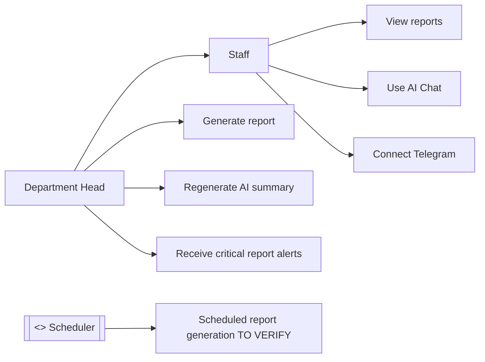

### 19.2 System Sequence Diagram

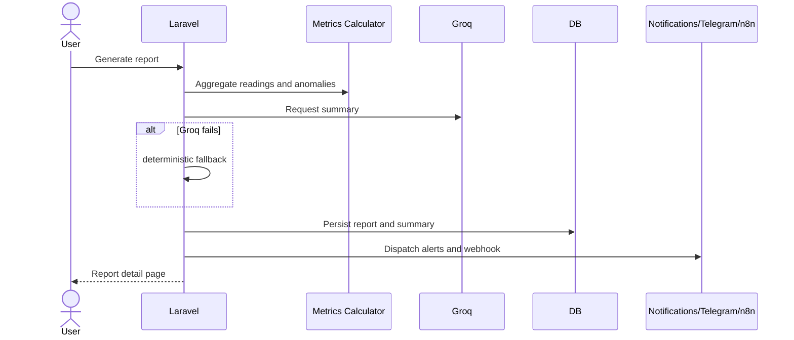

### 19.3 Scheduled Report Generation Pipeline

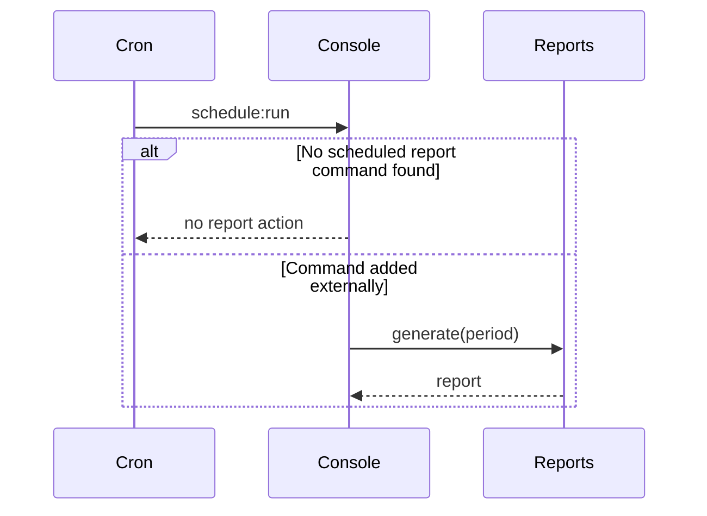

### 19.4 AI Chat Conversation Turn

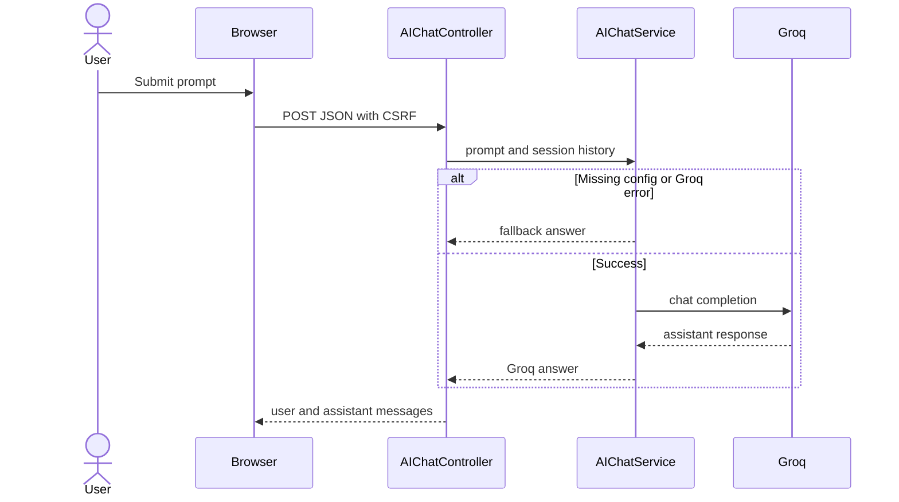

### 19.5 Telegram Account Linking

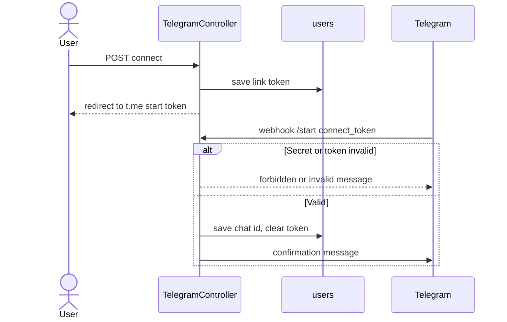

### 19.6 Critical-Report Alert Fan-Out

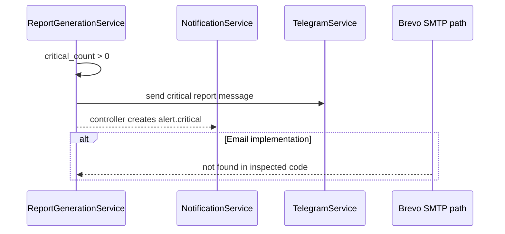

### 19.7 Class Diagram

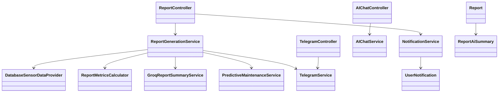

### 19.8 ER Diagram

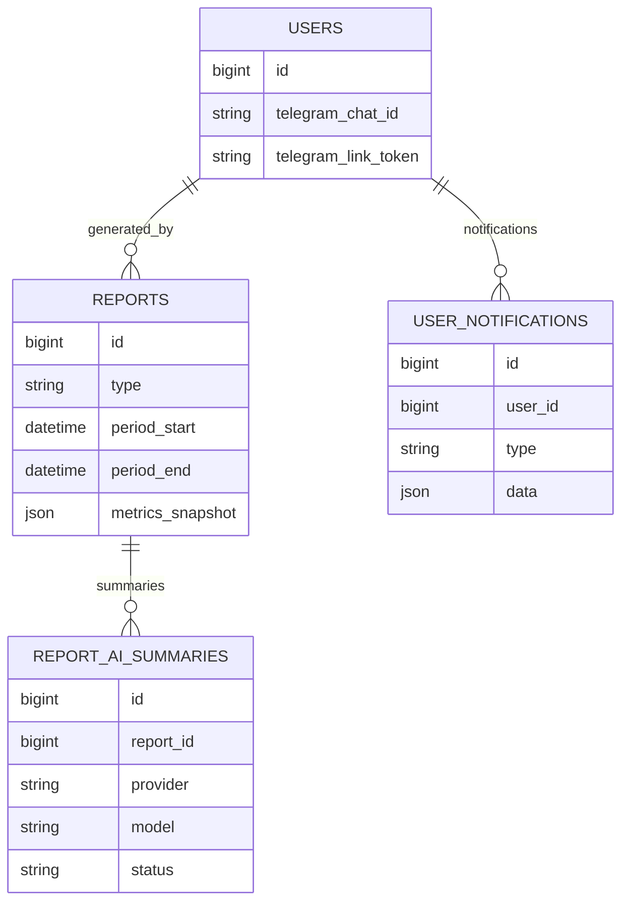

## 20. Report-Ready Paragraphs

### 20.1 Sprint Introduction

The Reports and AI Intelligence sprint extends the supervision platform from real-time monitoring toward operational decision support. Earlier sprints collected environmental and server telemetry, authenticated users, and established operational workflows. This sprint uses those stored records to generate structured reports, identify anomalies, summarize system behavior, and recommend preventive actions. It also introduces integrations with external services such as Groq, Telegram, and n8n. The result is a more analytical layer that helps users understand not only what is happening now, but also what trends and risks deserve attention. The implementation remains grounded in Laravel services, controllers, Eloquent models, Blade views, and MySQL persistence.

### 20.2 Functional Scope of the Sprint

The sprint implements manual report generation for daily, weekly, and monthly periods. Each report is built from stored environmental telemetry and registered server metrics. The report pipeline calculates averages, latest values, warning counts, critical counts, anomaly counts, trend directions, and spike anomalies. It then attempts to obtain an AI-generated executive summary from Groq and falls back to deterministic text if the provider is unavailable. Predictive maintenance recommendations are generated with explicit rule-based logic. The sprint also includes an AI Chat assistant, Telegram account linking, Telegram mobile alerts, in-app report notifications, and optional n8n webhook automation. Automatic scheduled report generation and critical-report email classes were not found in the inspected code and remain items to verify or complete.

### 20.3 Report Generation Pipeline

The report pipeline begins when a user submits the report form with a report type and reference date. Laravel resolves the period boundaries according to whether the report is daily, weekly, or monthly. The data provider loads sensor readings and server metrics from the database for that period. The metrics calculator classifies each value using threshold definitions, counts warnings and critical events, detects spikes, and produces a structured snapshot. The predictive maintenance service adds recommendations based on trend and severity rules. The report and its AI or fallback summary are persisted in a database transaction. After persistence, the system sends in-app notifications, Telegram critical alerts when needed, an optional n8n webhook, an audit log entry, and a broadcast event.

### 20.4 AI Integration Through Groq

Groq is integrated through an OpenAI-compatible chat completion request. The report summary service builds a compact prompt from calculated metrics, overview values, and a limited anomaly list. It asks the model to return valid JSON containing a summary, observations, and recommendations. The response parser first attempts direct JSON decoding and then tries to extract a JSON object from the returned content. If any stage fails, deterministic fallback text is generated from the same metrics. The AI Chat feature uses the same Groq configuration and includes recent session history with the current user message. Both integrations use synchronous HTTP calls and 20-second timeouts. The design keeps reporting usable even when the AI provider is unavailable.

### 20.5 Predictive Maintenance Rules

Predictive maintenance is implemented as deterministic business rules rather than a fully trained model inside Laravel. A rising temperature trend generates a cooling-efficiency recommendation. Humidity drifting outside the target band generates an environmental-control recommendation. Any critical latest metric generates an immediate preventive intervention recommendation. These rules are simple, explainable, and directly linked to the report metrics. Their main strength is transparency: every recommendation can be traced to a threshold, trend, or status value. The current implementation is therefore suitable for an academic PFE report because it demonstrates decision-support logic without claiming unsupported machine-learning behavior inside Laravel.

### 20.6 Telegram Integration and Account Linking

Telegram integration gives users a mobile alert channel outside the web interface. An approved user can start the connection flow from the profile page, where Laravel generates a one-time token and redirects to the configured Telegram bot. The Telegram webhook receives `/start` updates, validates the secret header when configured, matches the token to a user, stores the chat id, and clears the token. Once linked, users can receive Telegram alerts for maintenance assignment and team-chat mentions. Department Heads with linked Telegram accounts can also receive critical-report alerts. Telegram API failures are logged and do not interrupt the main application flow. This makes Telegram a secondary alert channel rather than a hard dependency.

### 20.7 n8n Automation as an Extension Point

The n8n integration is implemented as an optional webhook dispatch after report generation. When a webhook URL is configured, Laravel posts a compact payload containing the report id, type, warning count, critical count, reading count, summary, report URL, and creation timestamp. If no URL is configured, the integration is silently skipped. Failed responses and exceptions are logged, and the user-facing report generation flow continues. This design treats n8n as an extension point for external automation instead of a required dependency. It allows future workflows such as sending reports to external dashboards, messaging tools, or ticketing systems. A signed webhook mechanism would strengthen this integration in production.

### 20.8 Transactional Email Delivery via Brevo SMTP for Critical Alerts

The deployment fact for this audit states that Laravel Mail is configured through Brevo SMTP in production. The application mail configuration is provider-agnostic and uses standard `MAIL_*` variables, so Brevo is selected by deployment configuration rather than by a Brevo-specific SDK. In the inspected Sprint 4 code, no critical-report email notification class or weekly-report summary email class was found. Therefore, the report should describe Brevo SMTP as the available transactional email transport, but it should not claim that critical-report email alerts are implemented unless the missing notification is later added. Existing Laravel notifications from other sprints would use the same SMTP layer. For Sprint 4, implemented alert channels are in-app notifications and Telegram messages.

### 20.9 Sprint Conclusion and Outcomes

The sprint delivers a functional intelligence layer for the Server Room Supervision platform. Reports can be generated manually, stored historically, viewed in detail, and enriched with AI or fallback summaries. Metrics are computed from real database sources and include server health indicators as well as environmental telemetry. Predictive maintenance recommendations provide explainable next actions based on thresholds and trends. Telegram and n8n integrations extend the platform beyond the browser, while the AI Chat feature gives users a conversational operational assistant. The main gaps are scheduled report generation, critical-report email implementation, stronger audit coverage, and stricter authorization for report generation. These gaps are manageable and clearly separable from the implemented reporting core.

## 21. Screenshot Checklist for This Sprint

| # | Page | Route name | What to show |
|---|---|---|---|
| 1 | Reports list | `reports.index` | Report counters, type filters, saved report cards, and generation form. |
| 2 | Manual generation form | `reports.index` | Daily/weekly/monthly dropdown and reference date input. |
| 3 | Report detail | `reports.show` | Report title, period, summary badge, and metric cards. |
| 4 | AI summary block | `reports.show` | Executive summary, observations, recommendations, and Groq/fallback badge. |
| 5 | Anomalies table/list | `reports.show` | Spike anomalies with severity, value, and delta. |
| 6 | Predictive maintenance block | `reports.show` | Preventive recommendations and severity badges. |
| 7 | Summary history | `reports.show` | Multiple AI summary versions after regeneration. |
| 8 | AI Chat workspace | `ai-chat.index` | Prompt box, existing messages, Groq connected or fallback badge. |
| 9 | AI Chat conversation in progress | `ai-chat.index` | Thinking state and returned assistant message. |
| 10 | Profile Telegram connection | `profile.edit` | Telegram Alerts panel and Connect/Reconnect button. |
| 11 | Notification dropdown | global topbar | Report-generated or critical alert notification and unread badge. |
| 12 | Notification inbox | `notifications.index` | Critical alert and report notification rows. |
| 13 | Telegram phone screenshot | external Telegram app | Maintenance, mention, or critical report message received by the bot. |
| 14 | n8n workflow canvas | external n8n UI | Webhook trigger and downstream workflow nodes. |

## 22. Open Questions (TO VERIFY)

- The prompt calls this Sprint 4, while the existing sprint plan labels reports, AI, Telegram, and n8n as Sprint 5; confirm the final numbering for the internship report.
- Automatic scheduled report generation was not found in `routes/console.php` or `app/Console`; confirm whether production uses an external scheduler outside the repository.
- Manual report generation is currently available to any approved verified user, not Department Head-only; confirm whether this is intended.
- Critical-report email alerts and weekly-report summary emails were not found; confirm whether they should be implemented or documented as future work.
- No n8n workflow export JSON was found in the repository; provide the external workflow if it should be documented node-by-node.
- `N8N_REPORT_WEBHOOK_URL` is configured in `config/services.php`, but it was not present in the inspected `.env.example` service-key block; confirm whether the example file should include it.
- `TemperaturePredictionService` is not wired to any controller or route; confirm whether it is a prototype, deprecated, or planned extension.
- The prompt mentions scheduled daily, weekly, and monthly reports, but only manual report generation is implemented; confirm intended production automation.
- No audit entries were found for AI Chat, individual Groq calls, Telegram sends, or n8n webhook dispatch; confirm whether the audit requirement should be expanded.
- The separate `../ai-service` Isolation Forest sidecar exists outside `myapp`; confirm whether it should be part of this Sprint 4 report or part of a later AI predictive-maintenance sprint.
