# Sprint Authentication Complete Audit

## 1. Sprint Overview

- **Sprint name:** Authentication, approval, and account security sprint.
- **Position in project:** Early foundation sprint for the Server Room Supervision platform. The exact week numbers are TO VERIFY from the project Gantt; the codebase shows this sprint precedes protected dashboard, server, telemetry, maintenance, report, and chat features because those routes require authenticated and approved users.
- **Main objective:** This sprint establishes a secure identity and access-control layer for the Laravel 12 application. It covers user registration, Department Head bootstrap, invite-based Department Head onboarding, Staff approval, email verification, email-based two-factor authentication, password reset, role-based authorization, and audit logging. It converts the default Breeze-style authentication foundation into a controlled institutional workflow for a server-room supervision context.

High-level deliverables:

- Breeze-derived web authentication routes for registration, login, password reset, email verification, password confirmation, and logout are grouped in `routes/auth.php:39-128`.
- Staff registration creates pending Staff accounts and notifies approved Department Heads for review in `app/Http/Controllers/Auth/RegisteredUserController.php:65-101`.
- First Department Head bootstrap is available only while no Department Head account exists, and it validates the configured setup key in `app/Http/Controllers/Auth/FirstDepartmentHeadSetupController.php:15-67`.
- Department Head invitation creation, reveal, registration, consumption, and revocation are implemented through `app/Services/DepartmentHeadInviteService.php:19-124`, `app/Http/Controllers/Auth/DepartmentHeadInviteRegistrationController.php:25-130`, and `app/Http/Controllers/Admin/DepartmentHeadInviteController.php:13-30`.
- Email-based 2FA issues a six-digit code, stores a hash, expires after five minutes, and enforces three failed attempts in `app/Services/LoginTwoFactorService.php:74-182`.
- Dashboard and operational pages are protected by `auth`, `approved.user`, and `verified` middleware in `routes/web.php:70-88` and `routes/web.php:123-158`.
- Department Head user-management actions are protected by `department.head` middleware and model policy checks in `routes/web.php:93-105`, `app/Http/Controllers/Admin/UserManagementController.php:22-125`, and `app/Policies/UserPolicy.php:23-62`.
- Auth-related events are persisted in the audit log through `app/Services/AuditLogService.php:11-27`.

The authentication sprint enables the rest of the project by ensuring that only validated, approved, and role-appropriate users can reach sensitive monitoring and administration interfaces. Later sprints depend on this layer: the dashboard uses `auth`, `approved.user`, and `verified`; administrative pages require Department Head privileges; and private broadcast channels authorize subscriptions using the authenticated user's approval state in `routes/channels.php:21-35`.

## 2. Functional Requirements Covered

- Staff can open the registration page and create a pending Staff account through `routes/auth.php:40-47` and `app/Http/Controllers/Auth/RegisteredUserController.php:49-101`.
- Staff registration validates identity, department, phone, email uniqueness, and password confirmation through `app/Http/Requests/Auth/RegisterStaffRequest.php:17-51`.
- Staff accounts remain pending until a Department Head approves them, as stored in `role`, `status`, and `is_approved` in `app/Http/Controllers/Auth/RegisteredUserController.php:73-80`.
- Department Heads can approve or reject pending Staff through `routes/web.php:95-99` and `app/Http/Controllers/Admin/UserManagementController.php:42-95`.
- Department Heads can promote and demote users through `routes/web.php:101-104` and `app/Http/Controllers/Admin/UserManagementController.php:100-125`.
- The first Department Head can be bootstrapped with `DEPARTMENT_HEAD_REGISTRATION_KEY` while no Department Head exists, as enforced in `app/Http/Controllers/Auth/FirstDepartmentHeadSetupController.php:15-67`.
- Department Heads can invite other Department Heads by email through `routes/web.php:100-103` and `app/Services/DepartmentHeadInviteService.php:19-47`.
- Invite acceptance uses a reveal token and a separate authorization code, with reveal, validity, and registration checks in `app/Http/Controllers/Auth/DepartmentHeadInviteRegistrationController.php:25-130`.
- Login validates credentials, rate-limits failures, blocks pending or rejected accounts, and uses generic invalid-credential errors in `app/Http/Requests/Auth/LoginRequest.php:49-134`.
- Login requires email-based 2FA after credentials succeed, as wired in `app/Http/Controllers/Auth/AuthenticatedSessionController.php:30-43`.
- 2FA code verification logs in the user, regenerates the session, finalizes login security metadata, and redirects to the intended destination in `app/Http/Controllers/Auth/EmailTwoFactorChallengeController.php:36-49`.
- Logout clears pending 2FA state, logs out, invalidates the session, regenerates the CSRF token, and redirects home in `app/Http/Controllers/Auth/AuthenticatedSessionController.php:49-59`.
- Password reset is available through request, email token, and new password submission routes in `routes/auth.php:75-86`, `app/Http/Controllers/Auth/PasswordResetLinkController.php:17-41`, and `app/Http/Controllers/Auth/NewPasswordController.php:21-60`.
- Email verification uses Laravel's signed verification request and notification resend flow in `routes/auth.php:107-117`, `app/Http/Controllers/Auth/VerifyEmailController.php:15-25`, and `app/Http/Controllers/Auth/EmailVerificationNotificationController.php:14-22`.
- Profile email changes force re-verification by nulling `email_verified_at` when the email is modified in `app/Http/Controllers/ProfileController.php:27-35`.
- Auth-related notifications cover pending approval, new Staff registration, account approval, account rejection, Department Head invite, suspicious login, and 2FA code delivery in `app/Notifications/PendingApprovalNotification.php:13-26`, `app/Notifications/NewStaffRegistrationNotification.php:19-34`, `app/Notifications/AccountApprovedNotification.php:19-37`, `app/Notifications/AccountRejectedNotification.php:13-24`, `app/Notifications/DepartmentHeadInviteNotification.php:20-34`, `app/Notifications/SuspiciousLoginAlertNotification.php:24-51`, and `app/Notifications/LoginTwoFactorCodeNotification.php:18-31`.

## 3. User Roles and States

| Concept | Definition | Where defined | Cited file:line |
|---|---|---|---|
| Staff role | Default registered operational user role stored as `staff`. | Registration controller and user model helper. | `app/Http/Controllers/Auth/RegisteredUserController.php:73-80`; `app/Models/User.php:102-106` |
| Department Head role | Administrative role stored as `department_head`; it can approve, reject, invite, promote, and demote users. | User model helper and policy. | `app/Models/User.php:96-100`; `app/Policies/UserPolicy.php:23-62` |
| Legacy IT Staff role | `it_staff` is still accepted as Staff by `isStaff()` for backward compatibility. | User model. | `app/Models/User.php:102-106` |
| Pending approval | New Staff accounts are created with `status = pending` and `is_approved = false`. | Registration controller and migration. | `app/Http/Controllers/Auth/RegisteredUserController.php:73-80`; `database/migrations/2026_04_06_012145_add_status_and_phone_number_to_users_table.php:14-22` |
| Approved account | Approved accounts pass `hasApprovedStatus()` when `status` is `approved`, with a legacy fallback to `is_approved`. | User model. | `app/Models/User.php:108-113` |
| Rejected account | Rejection sets `status = rejected` and `is_approved = false`. | Admin controller. | `app/Http/Controllers/Admin/UserManagementController.php:73-95` |
| Email unverified | A user is unverified when `email_verified_at` is null; the model implements `MustVerifyEmail`. | User model and users migration. | `app/Models/User.php:35-44`; `database/migrations/0001_01_01_000000_create_users_table.php:17-28` |
| Email verified | Laravel marks `email_verified_at` after a signed verification request. | Verify email controller. | `app/Http/Controllers/Auth/VerifyEmailController.php:15-25` |
| Pending 2FA | After correct credentials, pending user id and remember choice are stored in session until the email code is verified. | 2FA service. | `app/Services/LoginTwoFactorService.php:14-29` |
| Completed 2FA | A valid OTP deletes the challenge, logs in the user, regenerates the session, and finalizes login. | 2FA controller and service. | `app/Http/Controllers/Auth/EmailTwoFactorChallengeController.php:36-49`; `app/Services/LoginTwoFactorService.php:121-182` |
| Suspended or banned | No explicit suspended or banned state was found; access control uses pending, approved, and rejected. | User migration and policy evidence. | `database/migrations/2026_04_06_012145_add_status_and_phone_number_to_users_table.php:14-22`; `app/Policies/UserPolicy.php:23-62` |

## 4. End-to-End Authentication Flows

### 4.1 First Department Head Bootstrap

- **Trigger:** A visitor opens `/setup/department-head` while no Department Head exists.
- **Step-by-step sequence:**
  1. The guest route exposes the setup form at `routes/auth.php:52-57`.
  2. The controller aborts unless no Department Head exists in `app/Http/Controllers/Auth/FirstDepartmentHeadSetupController.php:15-19`.
  3. Submission is validated by `StoreFirstDepartmentHeadSetupRequest` in `app/Http/Requests/Auth/StoreFirstDepartmentHeadSetupRequest.php:17-53`.
  4. The configured setup key is read from `config('services.registration.department_head_key')`, checked for presence, and compared with `hash_equals()` in `app/Http/Controllers/Auth/FirstDepartmentHeadSetupController.php:24-35`.
  5. The account is created as approved Department Head with a hashed password in `app/Http/Controllers/Auth/FirstDepartmentHeadSetupController.php:39-49`.
  6. Laravel email verification is sent, the audit action `auth.department_head.bootstrap.created` is recorded, and the user is redirected to login in `app/Http/Controllers/Auth/FirstDepartmentHeadSetupController.php:51-61`.
- **Validation rules:** name, unique email, department, phone format, setup key, and confirmed password are enforced in `app/Http/Requests/Auth/StoreFirstDepartmentHeadSetupRequest.php:26-53`.
- **Events and notifications:** Laravel email verification is sent in `app/Http/Controllers/Auth/FirstDepartmentHeadSetupController.php:51-51`.
- **DB tables written:** `users`, `audit_logs`.
- **Final state:** Approved Department Head, unverified email until verification link is used.
- **Edge cases and error paths:** Once a Department Head exists, both form and submission abort through `bootstrapAvailable()` in `app/Http/Controllers/Auth/FirstDepartmentHeadSetupController.php:15-24` and `app/Http/Controllers/Auth/FirstDepartmentHeadSetupController.php:64-67`; an invalid or missing key returns a validation error in `app/Http/Controllers/Auth/FirstDepartmentHeadSetupController.php:26-35`.

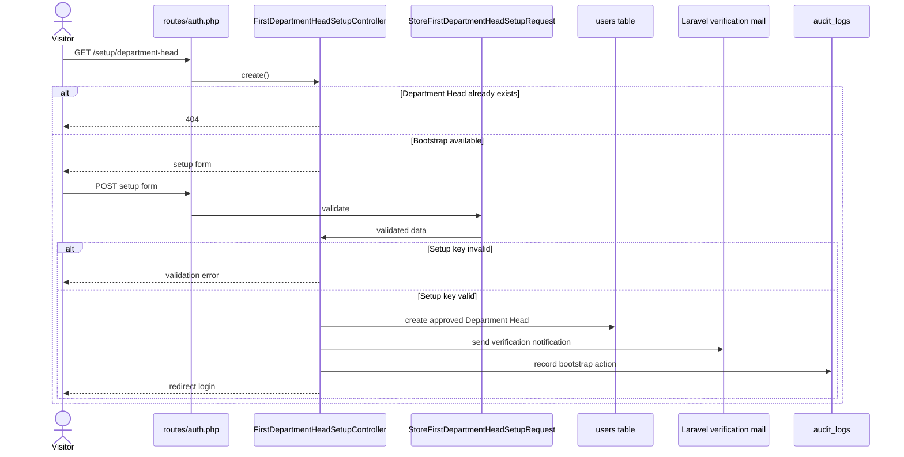

### 4.2 Staff Registration

- **Trigger:** A visitor submits the Staff registration form.
- **Step-by-step sequence:**
  1. The route displays and stores Staff registration in `routes/auth.php:40-47`.
  2. The controller provides the register view and indicates whether first Department Head setup is available in `app/Http/Controllers/Auth/RegisteredUserController.php:49-53`.
  3. The request normalizes email and phone input, then validates name, email, department, phone, and password fields in `app/Http/Requests/Auth/RegisterStaffRequest.php:17-51`.
  4. The controller creates a `staff` user with `status = pending`, `is_approved = false`, and a hashed password in `app/Http/Controllers/Auth/RegisteredUserController.php:65-81`.
  5. The user receives a pending-approval notification, approved Department Heads receive a new-Staff notification, and an audit record is written in `app/Http/Controllers/Auth/RegisteredUserController.php:83-96`.
  6. The user is redirected to the pending approval page in `app/Http/Controllers/Auth/RegisteredUserController.php:98-109`.
- **Validation rules:** `RegisterStaffRequest` requires valid personal data and `Rules\Password::defaults()` in `app/Http/Requests/Auth/RegisterStaffRequest.php:25-51`.
- **Events and notifications:** `PendingApprovalNotification` and `NewStaffRegistrationNotification` are sent in `app/Http/Controllers/Auth/RegisteredUserController.php:83-91`.
- **DB tables written:** `users`, `audit_logs`; notifications are sent through Laravel's notification system.
- **Final state:** Pending Staff, not approved, not authenticated.
- **Edge cases and error paths:** Duplicate email is blocked by the unique lower-email rule in `app/Http/Requests/Auth/RegisterStaffRequest.php:30-35`; pending users are blocked by login and middleware in `app/Http/Requests/Auth/LoginRequest.php:84-97` and `app/Http/Middleware/EnsureApprovedUser.php:12-25`.

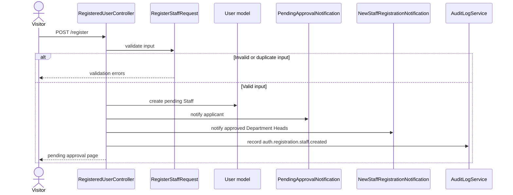

### 4.3 Department Head Invite

- **Trigger:** An approved Department Head creates an invitation, and the invitee follows the reveal and registration links.
- **Step-by-step sequence:**
  1. The admin invite routes are protected by `auth`, `verified`, and `department.head` in `routes/web.php:93-105`.
  2. Invite creation validates `invited_email` and blocks an already active invite in `app/Http/Requests/StoreDepartmentHeadInviteRequest.php:16-45`.
  3. The service creates a UUID invite, a 64-character reveal token, a derived authorization code, hashed token/code fields, and a one-day expiry in `app/Services/DepartmentHeadInviteService.php:19-32`.
  4. An on-demand invite notification sends the reveal URL without exposing the authorization code directly in `app/Services/DepartmentHeadInviteService.php:34-42`.
  5. The reveal route checks token validity, expiry, revocation, use, and one-time reveal state in `app/Http/Controllers/Auth/DepartmentHeadInviteRegistrationController.php:25-60`.
  6. The registration route checks whether the invite can be registered and validates identity plus the authorization code in `app/Http/Controllers/Auth/DepartmentHeadInviteRegistrationController.php:63-104`.
  7. A successful invite creates an approved Department Head, consumes the invite, sends email verification, writes audit logs, and redirects to login in `app/Http/Controllers/Auth/DepartmentHeadInviteRegistrationController.php:108-130`.
- **Validation rules:** invite creation uses `StoreDepartmentHeadInviteRequest` in `app/Http/Requests/StoreDepartmentHeadInviteRequest.php:16-45`; invitee registration uses `RegisterDepartmentHeadFromInviteRequest` in `app/Http/Requests/Auth/RegisterDepartmentHeadFromInviteRequest.php:17-56`.
- **Events and notifications:** `DepartmentHeadInviteNotification` is sent on demand in `app/Services/DepartmentHeadInviteService.php:34-42`; email verification is sent to the new Department Head in `app/Http/Controllers/Auth/DepartmentHeadInviteRegistrationController.php:120-121`.
- **DB tables written:** `department_head_invites`, `users`, `audit_logs`.
- **Final state:** Approved Department Head, invite marked used, email still requires verification.
- **Edge cases and error paths:** invalid reveal token, expired invite, revoked invite, already used invite, unrevealed invite, wrong authorization code, and email mismatch are handled in `app/Http/Controllers/Auth/DepartmentHeadInviteRegistrationController.php:25-104`.

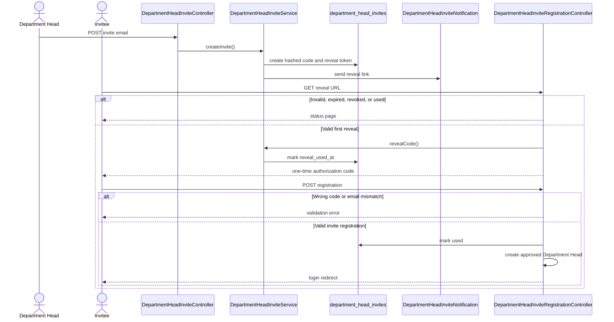

### 4.4 Department Head Approves Staff

- **Trigger:** Department Head submits the approve action from the admin users page.
- **Step-by-step sequence:**
  1. User-management routes are protected by `auth`, `verified`, and `department.head` in `routes/web.php:93-105`.
  2. The controller authorizes the `approve` policy method in `app/Http/Controllers/Admin/UserManagementController.php:42-43`.
  3. The policy permits approved Department Heads to approve pending users in `app/Policies/UserPolicy.php:29-35`.
  4. The controller sets `status = approved` and `is_approved = true` in `app/Http/Controllers/Admin/UserManagementController.php:45-49`.
  5. It sends account-approved and verification notifications, creates an in-app notification, writes `user.approved`, and redirects back in `app/Http/Controllers/Admin/UserManagementController.php:51-70`.
- **Validation rules:** No form request; authorization and route model binding are the main checks.
- **Events and notifications:** `AccountApprovedNotification`, Laravel email verification when needed, and in-app notification are triggered in `app/Http/Controllers/Admin/UserManagementController.php:51-63`.
- **DB tables written:** `users`, `audit_logs`, `user_notifications`.
- **Final state:** Approved Staff can verify email and complete login with 2FA.
- **Edge cases and error paths:** Non-Department Head users fail middleware/policy checks in `app/Http/Middleware/EnsureDepartmentHead.php:33-41` and `app/Policies/UserPolicy.php:29-35`.

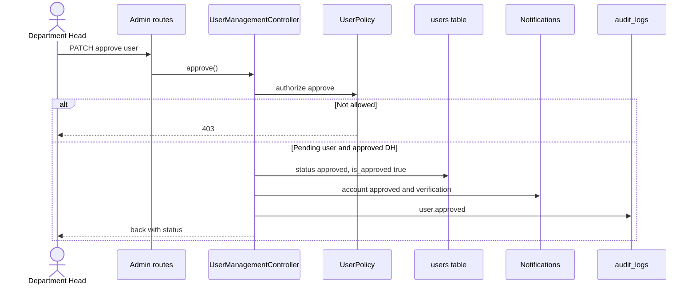

### 4.5 Department Head Rejects Staff

- **Trigger:** Department Head submits the reject action from the admin users page.
- **Step-by-step sequence:** The protected route invokes `reject()`, authorizes the policy, sets the user to rejected, sends email and in-app notifications, records `user.rejected`, and redirects back in `routes/web.php:95-99`, `app/Http/Controllers/Admin/UserManagementController.php:73-97`, and `app/Policies/UserPolicy.php:38-43`.
- **Validation rules:** No form request; policy restricts rejection to pending users.
- **Events and notifications:** `AccountRejectedNotification` and in-app notification are sent in `app/Http/Controllers/Admin/UserManagementController.php:82-90`.
- **DB tables written:** `users`, `audit_logs`, `user_notifications`.
- **Final state:** Rejected user remains unapproved and cannot authenticate successfully.
- **Edge cases and error paths:** Rejected users are denied during login with a rejected-account error in `app/Http/Requests/Auth/LoginRequest.php:84-97`.

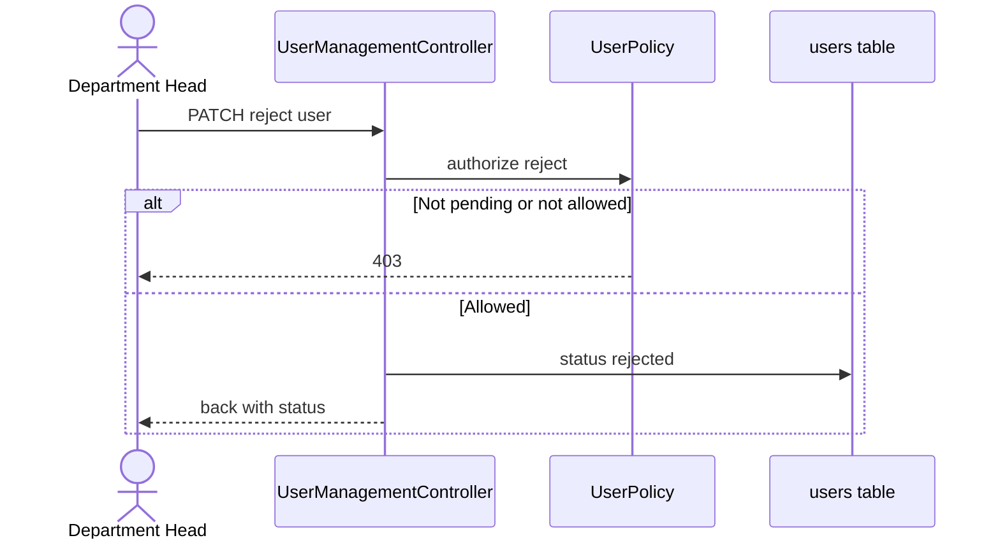

### 4.6 Department Head Promotes or Demotes a User

- **Trigger:** Department Head submits promote or demote from the admin user table.
- **Step-by-step sequence:** Routes map promote and demote actions in `routes/web.php:101-104`; controller methods authorize policy checks, update `role`, record audit entries, and redirect back in `app/Http/Controllers/Admin/UserManagementController.php:100-125`.
- **Validation rules:** Policy prevents self-promotion/demotion and restricts role changes to approved Department Heads in `app/Policies/UserPolicy.php:47-62`.
- **Events and notifications:** No email notification is sent for role changes; audit entries `user.promoted` and `user.demoted` are written in `app/Http/Controllers/Admin/UserManagementController.php:106-110` and `app/Http/Controllers/Admin/UserManagementController.php:121-125`.
- **DB tables written:** `users`, `audit_logs`.
- **Final state:** User role becomes `department_head` or `staff`.
- **Edge cases and error paths:** The policy blocks self changes and invalid target roles in `app/Policies/UserPolicy.php:47-62`.

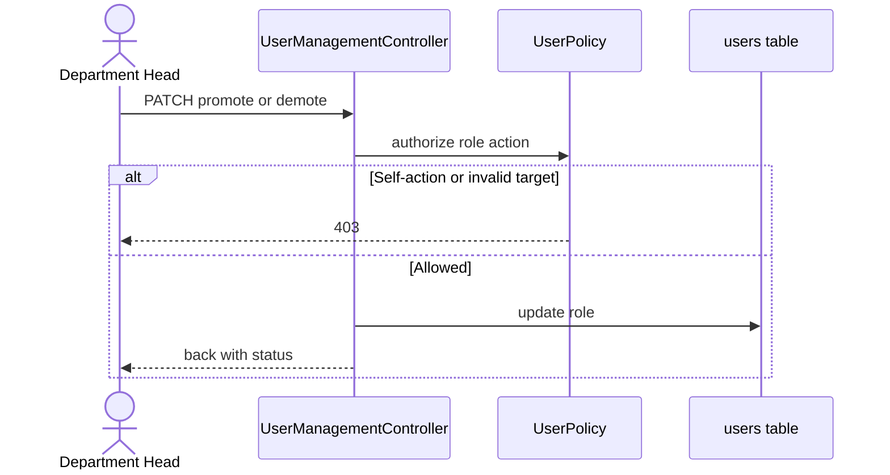

### 4.7 Login

- **Trigger:** A user submits email and password on the login page.
- **Step-by-step sequence:**
  1. Login GET and POST routes are declared in `routes/auth.php:70-73`.
  2. The login form posts email, password, remember, and CSRF fields in `resources/views/auth/login.blade.php:14-49`.
  3. `LoginRequest` validates the fields, normalizes the email, checks the user password or a dummy hash, and rate-limits failures in `app/Http/Requests/Auth/LoginRequest.php:35-75`.
  4. Pending or rejected accounts are denied and audited in `app/Http/Requests/Auth/LoginRequest.php:84-97`.
  5. The controller regenerates the session, starts a 2FA challenge, and redirects to the challenge page in `app/Http/Controllers/Auth/AuthenticatedSessionController.php:30-43`.
- **Validation rules:** Email and password are required in `app/Http/Requests/Auth/LoginRequest.php:35-41`.
- **Events and notifications:** 2FA email is sent by `LoginTwoFactorService::issueCode()` in `app/Services/LoginTwoFactorService.php:74-93`.
- **DB tables written:** `login_two_factor_challenges`, `audit_logs`.
- **Final state:** User is not fully authenticated yet; session stores pending 2FA state.
- **Edge cases and error paths:** invalid credentials, rate-limit lockout, pending account, rejected account, and password rehash are handled in `app/Http/Requests/Auth/LoginRequest.php:59-125`.

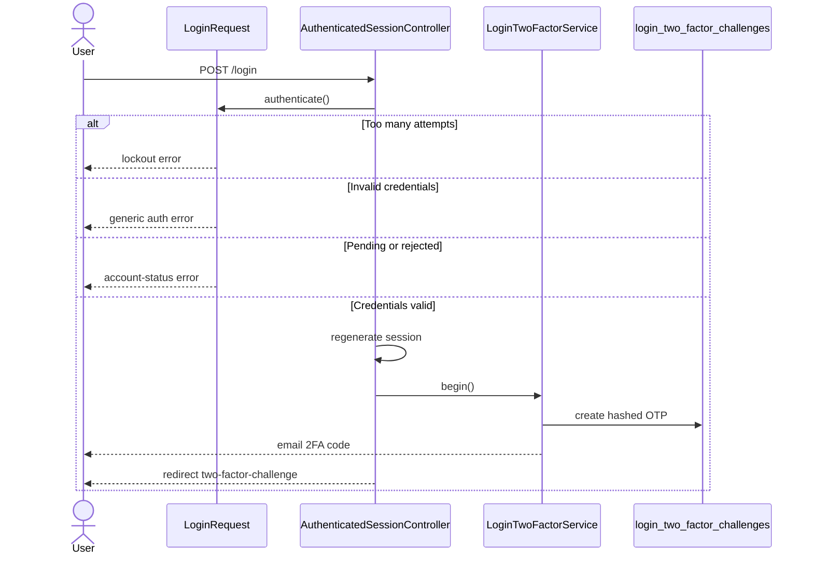

### 4.8 Email 2FA Challenge

- **Trigger:** A pending-2FA user submits the six-digit code.
- **Step-by-step sequence:** The route is protected by `pending-two-factor` in `routes/auth.php:88-102`; the controller validates and calls the service in `app/Http/Controllers/Auth/EmailTwoFactorChallengeController.php:36-49`; the service checks user state, challenge expiry, hash, attempt count, and success path in `app/Services/LoginTwoFactorService.php:121-182`; successful verification logs in the user, regenerates the session, clears pending state, finalizes login security metadata, and redirects.
- **Validation rules:** Code must be exactly six digits in `app/Http/Requests/Auth/VerifyTwoFactorCodeRequest.php:14-25`.
- **Events and notifications:** No event is dispatched directly; audit entries are written for expired, failed, and verified codes in `app/Services/LoginTwoFactorService.php:143-182`.
- **DB tables written:** `login_two_factor_challenges`, `audit_logs`, and user login metadata.
- **Final state:** Authenticated session with completed 2FA.
- **Edge cases and error paths:** missing challenge, expired challenge, invalid code, three failed attempts, resend cooldown, and cancel are implemented in `app/Services/LoginTwoFactorService.php:98-177` and `app/Http/Controllers/Auth/EmailTwoFactorChallengeController.php:52-64`.

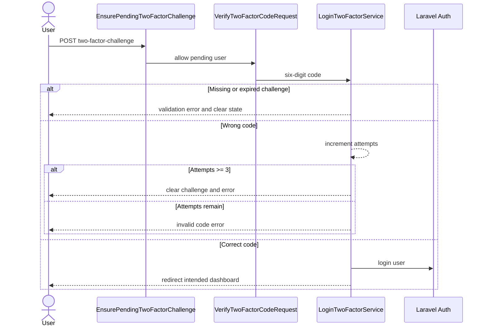

### 4.9 Logout

- **Trigger:** Authenticated user submits logout.
- **Step-by-step sequence:** The authenticated route is declared in `routes/auth.php:126-127`; the controller clears pending 2FA state, logs out through the web guard, invalidates the session, regenerates the CSRF token, and redirects to `/` in `app/Http/Controllers/Auth/AuthenticatedSessionController.php:49-59`.
- **Validation rules:** Web form CSRF protection applies through the Laravel web middleware stack.
- **Events and notifications:** None observed.
- **DB tables written:** Session row is invalidated by the session driver.
- **Final state:** Guest session.
- **Edge cases and error paths:** Pending 2FA state is cleared before logout in `app/Http/Controllers/Auth/AuthenticatedSessionController.php:51-52`.

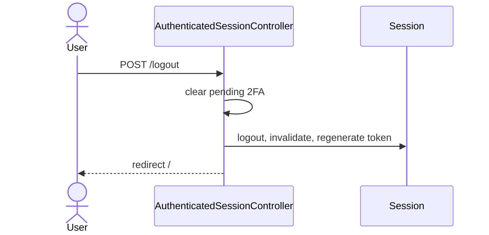

### 4.10 Password Reset

- **Trigger:** User requests a password reset email and later submits a new password with token.
- **Step-by-step sequence:** Routes are declared in `routes/auth.php:75-86`; request form and reset form are rendered by `PasswordResetLinkController` and `NewPasswordController` in `app/Http/Controllers/Auth/PasswordResetLinkController.php:17-41` and `app/Http/Controllers/Auth/NewPasswordController.php:21-60`; reset uses Laravel's broker, hashes the new password, rotates remember token, and dispatches `PasswordReset`.
- **Validation rules:** Email is required for link request in `app/Http/Controllers/Auth/PasswordResetLinkController.php:27-31`; reset requires token, email, and confirmed default password rules in `app/Http/Controllers/Auth/NewPasswordController.php:31-37`.
- **Events and notifications:** Laravel's built-in reset link notification is sent via `Password::sendResetLink()` in `app/Http/Controllers/Auth/PasswordResetLinkController.php:35-39`; `PasswordReset` event is dispatched in `app/Http/Controllers/Auth/NewPasswordController.php:50-50`.
- **DB tables written:** `password_reset_tokens`, `users`.
- **Final state:** Password changed and user redirected to login.
- **Edge cases and error paths:** Password reset link responses do not reveal whether an email exists because the controller always returns the sent-link status message in `app/Http/Controllers/Auth/PasswordResetLinkController.php:35-41`.

```mermaid
sequenceDiagram
    actor User
    participant Link as PasswordResetLinkController
    participant Broker as Password broker
    participant Reset as NewPasswordController
    User->>Link: POST forgot-password
    Link->>Broker: sendResetLink(email)
    Link-->>User: generic sent-link response
    User->>Reset: POST reset-password
    alt Invalid token or invalid password
        Reset-->>User: validation or broker error
    else Valid token
        Reset->>Reset: hash password, rotate remember token
        Reset-->>User: redirect login
    end
```

### 4.11 Email Verification

- **Trigger:** User clicks Laravel signed verification link or requests a new verification notification.
- **Step-by-step sequence:** Verification routes require authenticated users in `routes/auth.php:107-117`; the prompt redirects verified users or shows the notice in `app/Http/Controllers/Auth/EmailVerificationPromptController.php:15-19`; signed verification marks the email verified and dispatches `Verified` in `app/Http/Controllers/Auth/VerifyEmailController.php:15-25`; resend sends another notification in `app/Http/Controllers/Auth/EmailVerificationNotificationController.php:14-22`.
- **Validation rules:** Laravel's `EmailVerificationRequest` validates the signed URL in `app/Http/Controllers/Auth/VerifyEmailController.php:5-7`.
- **Events and notifications:** Laravel `Verified` event is dispatched in `app/Http/Controllers/Auth/VerifyEmailController.php:21-22`.
- **DB tables written:** `users.email_verified_at`.
- **Final state:** Verified user can access routes that require `verified`.
- **Edge cases and error paths:** Invalid hash is rejected by the signed verification request; tests cover this in `tests/Feature/Auth/EmailVerificationTest.php:44-57`.

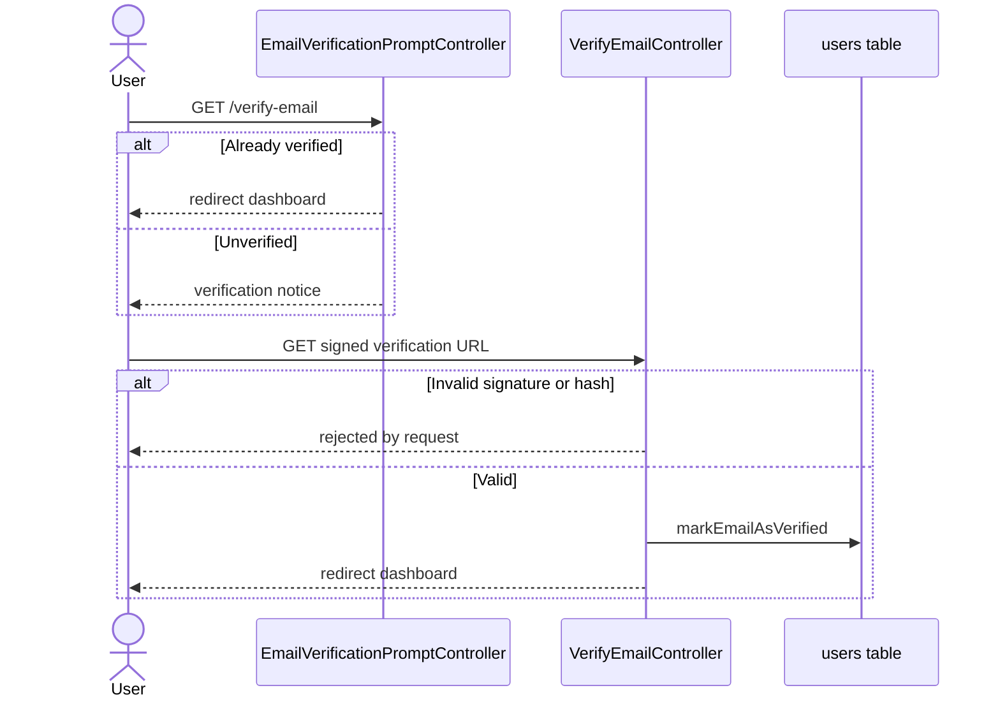

### 4.12 Email Change From Profile

- **Trigger:** Authenticated user updates profile information with a changed email address.
- **Step-by-step sequence:** Profile routes are protected by `auth` and `approved.user` in `routes/web.php:110-118`; `ProfileUpdateRequest` validates name and unique lower email in `app/Http/Requests/ProfileUpdateRequest.php:16-29`; the controller fills the user and sets `email_verified_at = null` when the email is dirty in `app/Http/Controllers/ProfileController.php:27-35`.
- **Validation rules:** `ProfileUpdateRequest` validates name and email uniqueness in `app/Http/Requests/ProfileUpdateRequest.php:16-29`.
- **Events and notifications:** No automatic verification email is sent in the update method; the Blade view exposes a verification resend form when the user is unverified in `resources/views/profile/partials/update-profile-information-form.blade.php:31-47`.
- **DB tables written:** `users`.
- **Final state:** Changed email becomes unverified until the user requests and completes verification.
- **Edge cases and error paths:** If the email remains unchanged, tests confirm verification status is preserved in `tests/Feature/ProfileTest.php:87-103`.

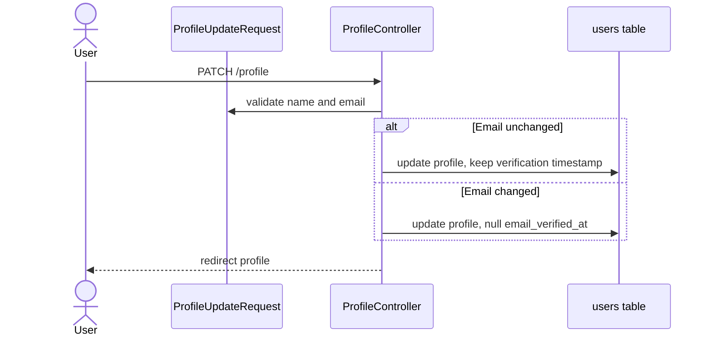

## 5. Email Two-Factor Authentication - Deep Dive

### Code Generation Algorithm

The OTP is a numeric six-digit code generated with `random_int(0, 999999)` and left-padded with zeroes. This uses PHP's cryptographically secure random integer API and guarantees a six-character numeric string in `app/Services/LoginTwoFactorService.php:74-77`.

### Code Storage

The code is not stored as plaintext. It is stored in `code_hash` using Laravel's `Hash::make()` inside `updateOrCreate()`, with attempts reset to zero and timestamps set in `app/Services/LoginTwoFactorService.php:78-87`. The model hides `code_hash` from array serialization in `app/Models/LoginTwoFactorChallenge.php:22-24`.

### Expiry Duration

The challenge expires five minutes after issue, set by `expires_at => now()->addMinutes(5)` in `app/Services/LoginTwoFactorService.php:82-85`. The model checks expiry with `expires_at->isPast()` in `app/Models/LoginTwoFactorChallenge.php:40-43`.

### Attempt Limit

Each failed verification increments `attempts`; if attempts reach three, the challenge is deleted and pending 2FA state is cleared in `app/Services/LoginTwoFactorService.php:154-177`.

### Challenge Scope

Challenges are scoped by `user_id`, and the migration makes `user_id` unique in `database/migrations/2026_05_05_090100_create_login_two_factor_challenges_table.php:11-19`. Pending 2FA state is scoped to the browser session through `auth.two_factor.user_id` and `auth.two_factor.remember` in `app/Services/LoginTwoFactorService.php:14-29`. The model relationship is declared in `app/Models/User.php:246-249`.

### Cleanup and Pruning

Expired or invalid challenges are deleted during verification and when pending state is cleared in `app/Services/LoginTwoFactorService.php:58-72` and `app/Services/LoginTwoFactorService.php:143-151`. No scheduled pruning command was found for expired challenges not revisited by the user. TO VERIFY whether this is intentional.

### Email Template

`LoginTwoFactorCodeNotification` sends a mail notification with a subject indicating a sign-in code, includes the generated code, states that it expires in five minutes, and tells the user to ignore the email if they did not attempt login in `app/Notifications/LoginTwoFactorCodeNotification.php:18-31`.

### Frontend Challenge Page

The challenge view posts the six-digit `code` field to `two-factor-challenge`, includes CSRF protection, offers a cancel action, and includes a resend form with a client-side cooldown display in `resources/views/auth/two-factor-challenge.blade.php:14-54`.

## 6. Brute-Force and Rate-Limit Protection

- Login rate limiting is implemented inside `LoginRequest`; it blocks after five attempts on the lowercased email plus IP key and dispatches `Lockout` in `app/Http/Requests/Auth/LoginRequest.php:101-134`.
- The registration route uses the named `register` limiter in `routes/auth.php:43-44`; the limiter allows 10 attempts per minute by normalized email and IP in `app/Providers/AppServiceProvider.php:83-90`.
- Password reset link requests use the `password-reset-links` limiter in `routes/auth.php:78-80`; the limiter allows five attempts per minute by email and IP in `app/Providers/AppServiceProvider.php:92-99`.
- Department Head invite creation is limited to five per minute by authenticated user id and IP in `app/Providers/AppServiceProvider.php:134-137`.
- Department Head invite reveal is limited to ten per minute by invite path and IP in `app/Providers/AppServiceProvider.php:147-152`.
- Invite registration is limited to five per minute by invite id, email, and IP in `app/Providers/AppServiceProvider.php:139-145`.
- 2FA verification is limited to ten attempts per minute by pending user id and IP in `routes/auth.php:92-94` and `app/Providers/AppServiceProvider.php:154-159`.
- 2FA resend is limited to five attempts per minute and also has a service-level 60-second resend cooldown in `routes/auth.php:96-98`, `app/Providers/AppServiceProvider.php:161-166`, and `app/Services/LoginTwoFactorService.php:108-116`.
- API token endpoint limiters for sensor and server metrics exist in `app/Providers/AppServiceProvider.php:101-132`, but they belong to telemetry rather than the authentication sprint.

## 7. Suspicious Login Detection

Suspicious login detection occurs after successful 2FA completion. `EmailTwoFactorChallengeController` calls `AuthenticationSecurityService::finalizeSuccessfulLogin()` after `Auth::login()` and session regeneration in `app/Http/Controllers/Auth/EmailTwoFactorChallengeController.php:42-47`. The service stores the current IP, user agent, and timestamp, then compares the previous IP to the current request IP; when a previous IP exists and differs, it sends `SuspiciousLoginAlertNotification` in `app/Services/AuthenticationSecurityService.php:17-39`. The notification email includes current IP, time, previous login context if present, and a profile action link in `app/Notifications/SuspiciousLoginAlertNotification.php:24-51`. Limitations: this check can produce false positives for mobile networks, VPNs, NAT, or proxy changes. No custom `TrustProxies` configuration was reviewed in this sprint document, so production proxy correctness remains TO VERIFY.

## 8. Authorization Layer

### Middleware

- `approved.user` is registered as an alias in `bootstrap/app.php:41-45`. Its implementation redirects unauthenticated or unapproved users to login, logs them out, invalidates the session, and regenerates the CSRF token in `app/Http/Middleware/EnsureApprovedUser.php:12-25`.
- `department.head` is registered in `bootstrap/app.php:41-45`. It requires an authenticated user who is a Department Head and has approved status; otherwise it aborts with 403 in `app/Http/Middleware/EnsureDepartmentHead.php:33-41`.
- `pending-two-factor` is registered in `bootstrap/app.php:41-45`. It allows only sessions with a valid pending 2FA user, clears invalid pending state, and redirects to login when needed in `app/Http/Middleware/EnsurePendingTwoFactorChallenge.php:13-32`.

### Policies

`UserPolicy` is registered for the `User` model in `app/Providers/AppServiceProvider.php:56-59`. It allows approved Department Heads to view user management in `app/Policies/UserPolicy.php:23-27`, approve and reject only pending users in `app/Policies/UserPolicy.php:29-43`, promote only non-self non-Department Heads in `app/Policies/UserPolicy.php:47-53`, and demote only non-self Department Heads in `app/Policies/UserPolicy.php:56-62`.

### Route Application

Dashboard routes use `auth`, `approved.user`, and `verified` in `routes/web.php:70-88`. User management routes use `auth`, `verified`, and `department.head` in `routes/web.php:93-105`. Profile routes use `auth` and `approved.user` in `routes/web.php:110-118`. Operational routes use `auth`, `approved.user`, and `verified` in `routes/web.php:123-158`.

### Broadcast Authorization

Private broadcast channels for dashboard telemetry and server status require an authenticated approved user in `routes/channels.php:21-31`, while the admin operations channel requires a Department Head in `routes/channels.php:33-35`.

## 9. Data Model - Auth-Related Tables

### users

- **Migration files:** base table in `database/migrations/0001_01_01_000000_create_users_table.php:17-28`; department and role in `database/migrations/2026_03_03_193501_add_department_and_role_to_users_table.php:14-17`; approval flag in `database/migrations/2026_03_03_201538_add_is_approved_to_users_table.php:14-21`; status and phone in `database/migrations/2026_04_06_012145_add_status_and_phone_number_to_users_table.php:14-22`; Telegram columns in `database/migrations/2026_04_06_020722_add_telegram_chat_id_to_users_table.php:11-14`; login security columns in `database/migrations/2026_05_05_090200_add_login_security_columns_to_users_table.php:11-15`.
- **Columns:** `id`, `name`, `email` unique, `email_verified_at` nullable, `password`, `remember_token`, timestamps, `department`, `role`, `is_approved`, `phone_number`, `status`, `telegram_chat_id`, `telegram_link_token`, `last_login_at`, `last_login_ip`, and `last_login_user_agent`.
- **Indexes:** `email` unique is defined in `database/migrations/0001_01_01_000000_create_users_table.php:19-19`.
- **Relationships:** user notifications, created/used Department Head invites, and one 2FA challenge are declared in `app/Models/User.php:229-249`.
- **Lifecycle:** rows are created by Staff registration, first Department Head setup, and invite registration; updated by approval, rejection, role changes, email verification, profile update, password change, and login metadata.

### login_two_factor_challenges

- **Migration file:** `database/migrations/2026_05_05_090100_create_login_two_factor_challenges_table.php:11-19`.
- **Columns:** `id`, `user_id` unique foreign key cascade, `code_hash`, `attempts` default 0, `last_attempt_at` nullable, `last_sent_at` nullable, `expires_at` indexed, timestamps.
- **Relationships:** belongs to User in `app/Models/LoginTwoFactorChallenge.php:35-38`.
- **Lifecycle:** created or replaced on login and resend, deleted after success, expiry, too many failures, cancel, or state clearing in `app/Services/LoginTwoFactorService.php:58-182`.

### department_head_invites

- **Migration file:** `database/migrations/2026_05_05_090000_create_department_head_invites_table.php:11-28`.
- **Columns:** `id`, `uuid` unique, `invited_email` indexed, `invited_by_user_id` foreign key cascade, `code_hash`, `reveal_token_hash`, `reveal_used_at`, `used_at` indexed nullable, `expires_at` indexed, `revoked_at`, `used_by_user_id` nullable foreign key null-on-delete, `failed_attempts`, `last_attempt_at`, timestamps.
- **Indexes:** `uuid` unique, `invited_email` index, `used_at` index, `expires_at` index, and composite `invited_email`, `revoked_at`, `used_at` in `database/migrations/2026_05_05_090000_create_department_head_invites_table.php:13-27`.
- **Relationships:** invited-by and used-by users are declared in `app/Models/DepartmentHeadInvite.php:49-57`.
- **Lifecycle:** created by Department Head invite, revealed once, used by registration, or revoked in admin flow.

### password_reset_tokens

- **Migration file:** `database/migrations/0001_01_01_000000_create_users_table.php:32-35`.
- **Columns:** `email` primary key, `token`, `created_at` nullable.
- **Lifecycle:** managed by Laravel's password broker when `Password::sendResetLink()` and `Password::reset()` run in `app/Http/Controllers/Auth/PasswordResetLinkController.php:35-39` and `app/Http/Controllers/Auth/NewPasswordController.php:42-52`.

### sessions

- **Migration file:** `database/migrations/0001_01_01_000000_create_users_table.php:40-47`.
- **Columns:** `id` primary key, `user_id` nullable indexed, `ip_address`, `user_agent`, `payload`, and `last_activity` indexed.
- **Lifecycle:** database-backed sessions are configured by `SESSION_DRIVER` through `config/session.php:19-23` and use the default `sessions` table in `config/session.php:86-90`.

### audit_logs

- **Migration file:** `database/migrations/2026_03_04_000001_create_audit_logs_table.php:14-21`.
- **Columns:** `id`, `actor_id` nullable foreign key null-on-delete, `action`, `target_type` nullable, `target_id` nullable, `metadata` JSON nullable, `created_at`.
- **Model:** metadata is cast to array and timestamps are disabled in `app/Models/AuditLog.php:8-27`.
- **Lifecycle:** created by `AuditLogService::record()` in `app/Services/AuditLogService.php:11-27`.

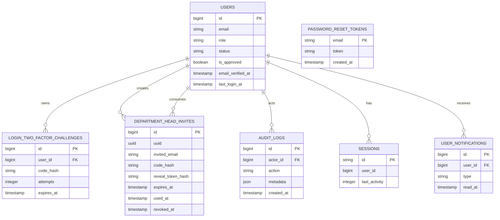

## 10. Notifications and Emails

| Class | Channels | Trigger | Recipient | Subject (paraphrased) | File:line |
|---|---|---|---|---|---|
| Laravel `VerifyEmail` | mail | First Department Head setup, invite registration, approval of unverified Staff, resend verification | User | Verify email address | `app/Http/Controllers/Auth/FirstDepartmentHeadSetupController.php:51-51`; `app/Http/Controllers/Auth/DepartmentHeadInviteRegistrationController.php:120-121`; `app/Http/Controllers/Admin/UserManagementController.php:53-55`; `app/Http/Controllers/Auth/EmailVerificationNotificationController.php:14-22` |
| Laravel password reset notification | mail | Forgot-password request | User matching email, if present | Reset password link | `app/Http/Controllers/Auth/PasswordResetLinkController.php:35-39` |
| `LoginTwoFactorCodeNotification` | mail | Credentials accepted or 2FA resend | Pending-login user | Sign-in verification code | `app/Notifications/LoginTwoFactorCodeNotification.php:18-31`; `app/Services/LoginTwoFactorService.php:74-93` |
| `PendingApprovalNotification` | mail | Staff registration | New Staff user | Account request received and pending | `app/Notifications/PendingApprovalNotification.php:13-26`; `app/Http/Controllers/Auth/RegisteredUserController.php:83-83` |
| `NewStaffRegistrationNotification` | mail | Staff registration | Approved Department Heads | New Staff account waiting approval | `app/Notifications/NewStaffRegistrationNotification.php:19-34`; `app/Http/Controllers/Auth/RegisteredUserController.php:85-91` |
| `AccountApprovedNotification` | mail | Department Head approval | Approved user | Account approved | `app/Notifications/AccountApprovedNotification.php:19-37`; `app/Http/Controllers/Admin/UserManagementController.php:51-55` |
| `AccountRejectedNotification` | mail | Department Head rejection | Rejected user | Account request declined | `app/Notifications/AccountRejectedNotification.php:13-24`; `app/Http/Controllers/Admin/UserManagementController.php:82-82` |
| `DepartmentHeadInviteNotification` | mail | Department Head invite creation | Invite email address | Department Head invitation | `app/Notifications/DepartmentHeadInviteNotification.php:20-34`; `app/Services/DepartmentHeadInviteService.php:34-42` |
| `SuspiciousLoginAlertNotification` | mail | Successful login from a different IP than previous login | User | New sign-in detected | `app/Notifications/SuspiciousLoginAlertNotification.php:24-51`; `app/Services/AuthenticationSecurityService.php:31-39` |

### Email Delivery Provider

The application sends authentication emails through Laravel Mail and Laravel Notifications over standard SMTP. In this deployment, the SMTP delivery provider is Brevo, formerly Sendinblue, as specified by the deployment fact provided for this audit. The codebase is provider-agnostic: no Brevo SDK, Brevo HTTP API client, or Brevo-specific service class was found in the authentication implementation. The SMTP choice is made by environment variables consumed by Laravel's mail configuration, including `MAIL_MAILER`, `MAIL_HOST`, `MAIL_PORT`, `MAIL_USERNAME`, `MAIL_PASSWORD`, `MAIL_ENCRYPTION`, `MAIL_FROM_ADDRESS`, and `MAIL_FROM_NAME`. These variables are referenced in `config/mail.php:19-52` and `config/mail.php:116-119`, and placeholder names are present in `.env.example:119-128`. This architecture keeps the application portable while allowing production transactional emails such as verification, password reset, OTP, approval, rejection, invite, and suspicious-login alerts to be relayed through Brevo SMTP.

## 11. Audit Logging

| Action key | Trigger | Evidence |
|---|---|---|
| `auth.registration.staff.created` | Staff registration | `app/Http/Controllers/Auth/RegisteredUserController.php:93-96` |
| `auth.department_head.bootstrap.created` | First Department Head setup | `app/Http/Controllers/Auth/FirstDepartmentHeadSetupController.php:53-56` |
| `auth.department_head.invite.created` | Department Head invite creation | `app/Services/DepartmentHeadInviteService.php:44-47` |
| `auth.department_head.invite.reveal_denied` | Invalid invite reveal token | `app/Http/Controllers/Auth/DepartmentHeadInviteRegistrationController.php:28-32` |
| `auth.department_head.invite.revealed` | Invite authorization code revealed | `app/Services/DepartmentHeadInviteService.php:75-79` |
| `auth.department_head.invite.code_failed` | Wrong invite authorization code | `app/Services/DepartmentHeadInviteService.php:92-101` |
| `auth.department_head.invite.used` | Invite consumed by new Department Head | `app/Services/DepartmentHeadInviteService.php:104-113` |
| `auth.department_head.invite.revoked` | Invite revoked | `app/Services/DepartmentHeadInviteService.php:116-124` |
| `auth.department_head.registration.completed` | Invited Department Head registration complete | `app/Http/Controllers/Auth/DepartmentHeadInviteRegistrationController.php:123-125` |
| `auth.login.failed` | Invalid credentials | `app/Http/Requests/Auth/LoginRequest.php:64-70` |
| `auth.login.denied` | Correct credentials but unapproved/rejected account | `app/Http/Requests/Auth/LoginRequest.php:84-91` |
| `auth.login.success` | Successful login after 2FA | `app/Services/AuthenticationSecurityService.php:41-45` |
| `auth.two_factor.challenge.started` | 2FA challenge started | `app/Services/LoginTwoFactorService.php:31-33` |
| `auth.two_factor.code.sent` | 2FA code issued or resent | `app/Services/LoginTwoFactorService.php:91-93` |
| `auth.two_factor.code.expired` | Expired 2FA code used | `app/Services/LoginTwoFactorService.php:143-151` |
| `auth.two_factor.code.failed` | Wrong 2FA code | `app/Services/LoginTwoFactorService.php:162-164` |
| `auth.two_factor.code.verified` | Correct 2FA code | `app/Services/LoginTwoFactorService.php:180-182` |
| `user.approved` | Staff approval | `app/Http/Controllers/Admin/UserManagementController.php:65-68` |
| `user.rejected` | Staff rejection | `app/Http/Controllers/Admin/UserManagementController.php:92-95` |
| `user.promoted` | User promoted to Department Head | `app/Http/Controllers/Admin/UserManagementController.php:106-110` |
| `user.demoted` | Department Head demoted to Staff | `app/Http/Controllers/Admin/UserManagementController.php:121-125` |

An audit row contains actor id, action, target type, target id, metadata, and creation timestamp, created through `app/Services/AuditLogService.php:11-27` and stored by the schema in `database/migrations/2026_03_04_000001_create_audit_logs_table.php:14-21`.

Actions not logged but probably worth adding:

- 🟡 Logout is not audited in `app/Http/Controllers/Auth/AuthenticatedSessionController.php:49-59`.
- 🟡 Password reset request and password reset completion are not audited in `app/Http/Controllers/Auth/PasswordResetLinkController.php:27-41` and `app/Http/Controllers/Auth/NewPasswordController.php:31-60`.
- 🟡 Email verification success and resend are not audited in `app/Http/Controllers/Auth/VerifyEmailController.php:15-25` and `app/Http/Controllers/Auth/EmailVerificationNotificationController.php:14-22`.
- 🟡 Profile email changes and password changes are not audited in `app/Http/Controllers/ProfileController.php:27-35` and `app/Http/Controllers/Auth/PasswordController.php:16-27`.

## 12. Configuration and Environment Variables

| Key | Default | Where used (file:line) | Purpose |
|---|---|---|---|
| `DEPARTMENT_HEAD_REGISTRATION_KEY` | `null` | `config/services.php:65-67`; `.env.example:145-145` | First Department Head bootstrap key. |
| `AUTH_GUARD` | `web` | `config/auth.php:16-19` | Default guard. |
| `AUTH_PASSWORD_BROKER` | `users` | `config/auth.php:93-99` | Password reset broker. |
| `SESSION_DRIVER` | `database` | `config/session.php:19-23`; `.env.example:47-47` | Session storage driver. |
| `SESSION_LIFETIME` | `120` minutes | `config/session.php:31-35`; `.env.example:48-48` | Session lifetime. |
| `SESSION_ENCRYPT` | `false` | `config/session.php:46-51`; `.env.example:49-49` | Whether session payloads are encrypted. |
| `SESSION_DOMAIN` | `null` | `config/session.php:151-155`; `.env.example:51-51` | Cookie domain. |
| `SESSION_SECURE_COOKIE` | `null` | `config/session.php:168-172` | Secure-cookie behavior. |
| `SESSION_SAME_SITE` | `lax` | `config/session.php:198-203` | SameSite cookie policy. |
| `BCRYPT_ROUNDS` | `12` in example | `.env.example:27-27` | Password hashing cost used by Laravel hashing defaults when configured. |
| `MAIL_MAILER` | `log` | `config/mail.php:19-19`; `.env.example:119-119` | Mail transport. In this deployment it is populated to send through Brevo SMTP. |
| `MAIL_HOST` | `127.0.0.1` | `config/mail.php:46-46`; `.env.example:120-120` | SMTP host. In this deployment it points to Brevo SMTP. |
| `MAIL_PORT` | `2525` | `config/mail.php:47-47`; `.env.example:121-121` | SMTP port for the mail provider. |
| `MAIL_USERNAME` | `null` | `config/mail.php:48-48`; `.env.example:122-122` | SMTP username. In production this is a Brevo SMTP credential. |
| `MAIL_PASSWORD` | `null` | `config/mail.php:49-49`; `.env.example:123-123` | SMTP password or key. In production this is a Brevo SMTP credential and must never be committed. |
| `MAIL_ENCRYPTION` | derived into scheme | `config/mail.php:3-3`; `config/mail.php:44-44`; `.env.example:124-124` | SMTP encryption mode. |
| `MAIL_FROM_ADDRESS` | `hello@example.com` | `config/mail.php:117-117`; `.env.example:127-127` | Sender email for auth notifications. |
| `MAIL_FROM_NAME` | `Example` | `config/mail.php:118-118`; `.env.example:128-128` | Sender name for auth notifications. |

The Brevo SMTP choice is deployment configuration, not application logic. The repository uses Laravel's provider-agnostic SMTP configuration, so changing providers would normally require only environment changes, not code changes.

## 13. Frontend Pages - Auth UI Inventory

| Route | View file | Purpose | Form fields | CSRF | Validation messages source |
|---|---|---|---|---|---|
| `GET /login`, `POST /login` | `resources/views/auth/login.blade.php` | Login page | email, password, remember | Yes, `resources/views/auth/login.blade.php:14-15` | `LoginRequest`, `resources/views/auth/login.blade.php:18-49` |
| `GET /register`, `POST /register` | `resources/views/auth/register.blade.php` | Staff registration | name, email, department, phone_number, password, password_confirmation | Yes, `resources/views/auth/register.blade.php:12-13` | `RegisterStaffRequest`, `resources/views/auth/register.blade.php:15-66` |
| `GET /register/pending-approval` | `resources/views/auth/pending-approval.blade.php` | Pending status page | none | Not applicable | Controller-provided email, `resources/views/auth/pending-approval.blade.php:18-27` |
| `GET /setup/department-head`, `POST /setup/department-head` | `resources/views/auth/department-head-setup.blade.php` | First Department Head setup | name, email, department, phone_number, setup_key, password, password_confirmation | Yes, `resources/views/auth/department-head-setup.blade.php:12-13` | `StoreFirstDepartmentHeadSetupRequest`, `resources/views/auth/department-head-setup.blade.php:15-61` |
| `GET /register/department-head` | `resources/views/auth/department-head-invite-entry.blade.php` | Department Head invite entry page | none | Not applicable | Controller state, `resources/views/auth/department-head-invite-entry.blade.php:2-24` |
| Invite reveal URL | `resources/views/auth/department-head-invite-revealed.blade.php` | One-time display of invite authorization code | none | Not applicable | Controller state, `resources/views/auth/department-head-invite-revealed.blade.php:12-22` |
| Invite status | `resources/views/auth/department-head-invite-status.blade.php` | Invalid, expired, revoked, or used invite status | none | Not applicable | Controller state, `resources/views/auth/department-head-invite-status.blade.php:2-9` |
| Invite register URL | `resources/views/auth/department-head-invite-register.blade.php` | Invited Department Head registration | email, name, department, phone_number, authorization_code, password, password_confirmation | Yes, `resources/views/auth/department-head-invite-register.blade.php:12-13` | `RegisterDepartmentHeadFromInviteRequest`, `resources/views/auth/department-head-invite-register.blade.php:15-64` |
| `GET /two-factor-challenge`, `POST /two-factor-challenge` | `resources/views/auth/two-factor-challenge.blade.php` | Email OTP entry, resend, cancel | code | Yes, `resources/views/auth/two-factor-challenge.blade.php:14-15` | `VerifyTwoFactorCodeRequest`, `resources/views/auth/two-factor-challenge.blade.php:17-54` |
| `GET /forgot-password`, `POST /forgot-password` | `resources/views/auth/forgot-password.blade.php` | Password reset link request | email | Yes, `resources/views/auth/forgot-password.blade.php:14-15` | Controller validation, `resources/views/auth/forgot-password.blade.php:18-21` |
| `GET /reset-password/{token}`, `POST /reset-password` | `resources/views/auth/reset-password.blade.php` | New password with token | token, email, password, password_confirmation | Yes, `resources/views/auth/reset-password.blade.php:12-13` | Controller validation, `resources/views/auth/reset-password.blade.php:16-40` |
| `GET /verify-email` | `resources/views/auth/verify-email.blade.php` | Email verification notice and resend | none for notice; resend form only | Yes for resend and logout, `resources/views/auth/verify-email.blade.php:18-35` | Built-in Laravel verification response |
| `GET /confirm-password`, `POST /confirm-password` | `resources/views/auth/confirm-password.blade.php` | Password confirmation | password | Yes, `resources/views/auth/confirm-password.blade.php:12-13` | Controller validation, `resources/views/auth/confirm-password.blade.php:16-24` |
| `/admin/users` | `resources/views/admin/users/index.blade.php` | User approval, role changes, DH invites | invite email and action forms | Yes in each form, `resources/views/admin/users/index.blade.php:34-55`, `resources/views/admin/users/index.blade.php:168-182`, `resources/views/admin/users/index.blade.php:249-270` | Request, policy, controller validation |
| `/profile` | `resources/views/profile/edit.blade.php` and partials | Profile, email, password, delete account | profile fields, password fields, deletion password | Yes, `resources/views/profile/partials/update-profile-information-form.blade.php:16-18`, `resources/views/profile/partials/update-password-form.blade.php:12-15`, `resources/views/profile/partials/delete-user-form.blade.php:18-20` | `ProfileUpdateRequest` and controller validation |

## 14. Test Coverage

### Existing Test Methods

| Path | Test class | Test method | What it asserts |
|---|---|---|---|
| `tests/Feature/Auth/AuthenticationTest.php` | `AuthenticationTest` | `test_login_screen_can_be_rendered` | Login page returns OK. `tests/Feature/Auth/AuthenticationTest.php:15-20` |
| `tests/Feature/Auth/AuthenticationTest.php` | `AuthenticationTest` | `test_approved_staff_are_redirected_to_the_two_factor_challenge_after_password_login` | Approved Staff password login starts 2FA, stores challenge, and sends code. `tests/Feature/Auth/AuthenticationTest.php:22-40` |
| `tests/Feature/Auth/AuthenticationTest.php` | `AuthenticationTest` | `test_approved_users_can_start_two_factor_with_mixed_case_email_input` | Email normalization allows mixed-case email login. `tests/Feature/Auth/AuthenticationTest.php:42-61` |
| `tests/Feature/Auth/AuthenticationTest.php` | `AuthenticationTest` | `test_pending_users_can_not_authenticate` | Pending users cannot log in and no 2FA challenge is created. `tests/Feature/Auth/AuthenticationTest.php:63-87` |
| `tests/Feature/Auth/AuthenticationTest.php` | `AuthenticationTest` | `test_rejected_users_can_not_authenticate` | Rejected users cannot log in and no 2FA challenge is created. `tests/Feature/Auth/AuthenticationTest.php:89-113` |
| `tests/Feature/Auth/AuthenticationTest.php` | `AuthenticationTest` | `test_users_can_not_authenticate_with_invalid_password` | Invalid password keeps the user guest. `tests/Feature/Auth/AuthenticationTest.php:115-125` |
| `tests/Feature/Auth/AuthenticationTest.php` | `AuthenticationTest` | `test_department_heads_are_redirected_to_the_two_factor_challenge_after_password_login` | Department Head password login starts 2FA and sends code. `tests/Feature/Auth/AuthenticationTest.php:127-141` |
| `tests/Feature/Auth/AuthenticationTest.php` | `AuthenticationTest` | `test_users_can_logout` | Logout redirects home and clears authenticated state. `tests/Feature/Auth/AuthenticationTest.php:143-151` |
| `tests/Feature/Auth/DepartmentHeadTwoFactorTest.php` | `DepartmentHeadTwoFactorTest` | `test_approved_staff_login_redirects_to_two_factor_challenge` | Staff login redirects to 2FA and stores challenge. `tests/Feature/Auth/DepartmentHeadTwoFactorTest.php:16-37` |
| `tests/Feature/Auth/DepartmentHeadTwoFactorTest.php` | `DepartmentHeadTwoFactorTest` | `test_approved_staff_can_not_access_dashboard_before_two_factor_is_completed` | Pending 2FA Staff cannot access dashboard. `tests/Feature/Auth/DepartmentHeadTwoFactorTest.php:39-61` |
| `tests/Feature/Auth/DepartmentHeadTwoFactorTest.php` | `DepartmentHeadTwoFactorTest` | `test_valid_otp_completes_staff_login` | Correct OTP authenticates Staff and deletes challenge. `tests/Feature/Auth/DepartmentHeadTwoFactorTest.php:63-89` |
| `tests/Feature/Auth/DepartmentHeadTwoFactorTest.php` | `DepartmentHeadTwoFactorTest` | `test_staff_wrong_otp_fails` | Wrong OTP returns errors and keeps user guest. `tests/Feature/Auth/DepartmentHeadTwoFactorTest.php:91-117` |
| `tests/Feature/Auth/DepartmentHeadTwoFactorTest.php` | `DepartmentHeadTwoFactorTest` | `test_staff_expired_otp_fails` | Expired OTP fails and clears challenge. `tests/Feature/Auth/DepartmentHeadTwoFactorTest.php:119-150` |
| `tests/Feature/Auth/DepartmentHeadTwoFactorTest.php` | `DepartmentHeadTwoFactorTest` | `test_department_head_can_not_access_dashboard_before_two_factor_is_completed` | Pending 2FA Department Head cannot access dashboard. `tests/Feature/Auth/DepartmentHeadTwoFactorTest.php:152-168` |
| `tests/Feature/Auth/DepartmentHeadTwoFactorTest.php` | `DepartmentHeadTwoFactorTest` | `test_valid_otp_completes_department_head_login` | Correct OTP authenticates Department Head and deletes challenge. `tests/Feature/Auth/DepartmentHeadTwoFactorTest.php:170-192` |
| `tests/Feature/Auth/DepartmentHeadTwoFactorTest.php` | `DepartmentHeadTwoFactorTest` | `test_expired_otp_fails` | Expired Department Head OTP fails. `tests/Feature/Auth/DepartmentHeadTwoFactorTest.php:194-218` |
| `tests/Feature/Auth/DepartmentHeadTwoFactorTest.php` | `DepartmentHeadTwoFactorTest` | `test_too_many_wrong_otp_attempts_clear_the_challenge` | Three wrong OTP attempts clear the challenge. `tests/Feature/Auth/DepartmentHeadTwoFactorTest.php:220-242` |
| `tests/Feature/Auth/DepartmentHeadTwoFactorTest.php` | `DepartmentHeadTwoFactorTest` | `test_resend_otp_observes_a_cooldown_and_then_succeeds` | Resend respects cooldown then sends a second code. `tests/Feature/Auth/DepartmentHeadTwoFactorTest.php:244-266` |
| `tests/Feature/Auth/DepartmentHeadInviteTest.php` | `DepartmentHeadInviteTest` | `test_approved_department_head_can_create_an_invite` | Approved Department Head can create an invite and notification. `tests/Feature/Auth/DepartmentHeadInviteTest.php:17-34` |
| `tests/Feature/Auth/DepartmentHeadInviteTest.php` | `DepartmentHeadInviteTest` | `test_staff_can_not_create_department_head_invites` | Staff cannot create Department Head invites. `tests/Feature/Auth/DepartmentHeadInviteTest.php:36-45` |
| `tests/Feature/Auth/DepartmentHeadInviteTest.php` | `DepartmentHeadInviteTest` | `test_reveal_link_shows_the_code_only_once_and_successful_registration_creates_an_unverified_department_head` | Reveal is one-time and valid registration creates approved unverified Department Head. `tests/Feature/Auth/DepartmentHeadInviteTest.php:47-101` |
| `tests/Feature/Auth/DepartmentHeadInviteTest.php` | `DepartmentHeadInviteTest` | `test_expired_or_revoked_invites_can_not_be_revealed_or_used` | Expired and revoked invites are rejected. `tests/Feature/Auth/DepartmentHeadInviteTest.php:103-115` |
| `tests/Feature/Auth/DepartmentHeadInviteTest.php` | `DepartmentHeadInviteTest` | `test_invite_code_is_bound_to_the_invited_email` | Invite authorization code cannot be reused with another email. `tests/Feature/Auth/DepartmentHeadInviteTest.php:117-143` |
| `tests/Feature/Auth/FirstDepartmentHeadSetupTest.php` | `FirstDepartmentHeadSetupTest` | `test_register_screen_shows_first_setup_link_when_no_department_head_exists` | Register page shows setup link before a Department Head exists. `tests/Feature/Auth/FirstDepartmentHeadSetupTest.php:15-21` |
| `tests/Feature/Auth/FirstDepartmentHeadSetupTest.php` | `FirstDepartmentHeadSetupTest` | `test_register_screen_hides_first_setup_link_when_department_head_exists` | Register page hides setup link after a Department Head exists. `tests/Feature/Auth/FirstDepartmentHeadSetupTest.php:23-31` |
| `tests/Feature/Auth/FirstDepartmentHeadSetupTest.php` | `FirstDepartmentHeadSetupTest` | `test_first_department_head_setup_screen_can_be_rendered_when_no_department_head_exists` | Setup page renders before a Department Head exists. `tests/Feature/Auth/FirstDepartmentHeadSetupTest.php:33-37` |
| `tests/Feature/Auth/FirstDepartmentHeadSetupTest.php` | `FirstDepartmentHeadSetupTest` | `test_first_department_head_can_be_created_only_when_no_department_head_exists` | Correct setup key creates first Department Head and sends verification. `tests/Feature/Auth/FirstDepartmentHeadSetupTest.php:39-65` |
| `tests/Feature/Auth/FirstDepartmentHeadSetupTest.php` | `FirstDepartmentHeadSetupTest` | `test_setup_key_becomes_useless_after_the_first_department_head_exists` | Setup route is unavailable after first Department Head exists. `tests/Feature/Auth/FirstDepartmentHeadSetupTest.php:67-90` |
| `tests/Feature/Auth/EmailVerificationTest.php` | `EmailVerificationTest` | `test_email_verification_screen_can_be_rendered` | Verification notice renders for authenticated unverified user. `tests/Feature/Auth/EmailVerificationTest.php:16-23` |
| `tests/Feature/Auth/EmailVerificationTest.php` | `EmailVerificationTest` | `test_email_can_be_verified` | Valid signed URL marks email verified. `tests/Feature/Auth/EmailVerificationTest.php:25-42` |
| `tests/Feature/Auth/EmailVerificationTest.php` | `EmailVerificationTest` | `test_email_is_not_verified_with_invalid_hash` | Invalid verification hash does not verify email. `tests/Feature/Auth/EmailVerificationTest.php:44-57` |
| `tests/Feature/Auth/PasswordResetTest.php` | `PasswordResetTest` | `test_reset_password_link_screen_can_be_rendered` | Forgot-password page renders. `tests/Feature/Auth/PasswordResetTest.php:15-20` |
| `tests/Feature/Auth/PasswordResetTest.php` | `PasswordResetTest` | `test_reset_password_link_can_be_requested` | Existing user can request reset link. `tests/Feature/Auth/PasswordResetTest.php:22-32` |
| `tests/Feature/Auth/PasswordResetTest.php` | `PasswordResetTest` | `test_reset_password_request_does_not_reveal_whether_an_email_exists` | Reset request response hides whether the email exists. `tests/Feature/Auth/PasswordResetTest.php:34-43` |
| `tests/Feature/Auth/PasswordResetTest.php` | `PasswordResetTest` | `test_reset_password_screen_can_be_rendered` | Reset form renders from token URL. `tests/Feature/Auth/PasswordResetTest.php:45-60` |
| `tests/Feature/Auth/PasswordResetTest.php` | `PasswordResetTest` | `test_password_can_be_reset_with_valid_token` | Valid token changes password and redirects. `tests/Feature/Auth/PasswordResetTest.php:62-84` |
| `tests/Feature/Auth/PasswordConfirmationTest.php` | `PasswordConfirmationTest` | `test_confirm_password_screen_can_be_rendered` | Password confirmation page renders. `tests/Feature/Auth/PasswordConfirmationTest.php:13-20` |
| `tests/Feature/Auth/PasswordConfirmationTest.php` | `PasswordConfirmationTest` | `test_password_can_be_confirmed` | Correct password confirms session password. `tests/Feature/Auth/PasswordConfirmationTest.php:22-32` |
| `tests/Feature/Auth/PasswordConfirmationTest.php` | `PasswordConfirmationTest` | `test_password_is_not_confirmed_with_invalid_password` | Invalid password does not confirm. `tests/Feature/Auth/PasswordConfirmationTest.php:34-43` |
| `tests/Feature/Auth/PasswordUpdateTest.php` | `PasswordUpdateTest` | `test_password_can_be_updated` | Authenticated user can update password with correct current password. `tests/Feature/Auth/PasswordUpdateTest.php:14-32` |
| `tests/Feature/Auth/PasswordUpdateTest.php` | `PasswordUpdateTest` | `test_correct_password_must_be_provided_to_update_password` | Wrong current password blocks password update. `tests/Feature/Auth/PasswordUpdateTest.php:34-50` |
| `tests/Feature/Auth/RegistrationTest.php` | `RegistrationTest` | `test_registration_screen_can_be_rendered` | Registration page returns OK. `tests/Feature/Auth/RegistrationTest.php:16-21` |
| `tests/Feature/Auth/RegistrationTest.php` | `RegistrationTest` | `test_new_users_can_register_with_any_valid_email_as_pending_staff_by_default` | New registration creates pending Staff and redirects to pending page. `tests/Feature/Auth/RegistrationTest.php:23-51` |
| `tests/Feature/Auth/RegistrationTest.php` | `RegistrationTest` | `test_pending_staff_can_not_access_dashboard_until_approved_and_verified` | Pending Staff cannot access dashboard. `tests/Feature/Auth/RegistrationTest.php:53-62` |
| `tests/Feature/Auth/RegistrationTest.php` | `RegistrationTest` | `test_approved_but_unverified_staff_are_redirected_to_email_verification_notice` | Approved unverified Staff is redirected to verification notice. `tests/Feature/Auth/RegistrationTest.php:64-74` |
| `tests/Feature/Admin/UserManagementTest.php` | `UserManagementTest` | `test_approved_department_head_can_view_the_users_page` | Approved Department Head can view users page. `tests/Feature/Admin/UserManagementTest.php:17-28` |
| `tests/Feature/Admin/UserManagementTest.php` | `UserManagementTest` | `test_staff_can_not_view_the_users_page` | Staff is forbidden from users page. `tests/Feature/Admin/UserManagementTest.php:30-41` |
| `tests/Feature/Admin/UserManagementTest.php` | `UserManagementTest` | `test_department_head_can_approve_a_pending_user` | Department Head can approve pending user and notification is sent. `tests/Feature/Admin/UserManagementTest.php:43-70` |
| `tests/Feature/Admin/UserManagementTest.php` | `UserManagementTest` | `test_department_head_can_reject_a_pending_user_and_send_email` | Department Head can reject pending user and notification is sent. `tests/Feature/Admin/UserManagementTest.php:72-89` |
| `tests/Feature/Admin/UserManagementTest.php` | `UserManagementTest` | `test_department_head_can_promote_and_demote_users` | Department Head can promote and demote another user. `tests/Feature/Admin/UserManagementTest.php:91-120` |
| `tests/Feature/ProfileTest.php` | `ProfileTest` | `test_profile_information_can_be_updated` | Profile updates can change email and force re-verification. `tests/Feature/ProfileTest.php:24-44` |
| `tests/Feature/ProfileTest.php` | `ProfileTest` | `test_email_verification_status_is_unchanged_when_the_email_address_is_unchanged` | Unchanged email keeps verification timestamp. `tests/Feature/ProfileTest.php:87-103` |
| `tests/Feature/ProfileTest.php` | `ProfileTest` | `test_user_can_delete_their_account` | Account deletion logs out and removes user. `tests/Feature/ProfileTest.php:105-121` |

### Coverage Summary

| Feature | Has test? | Test file | Notes |
|---|---|---|---|
| Login page rendering | Yes | `tests/Feature/Auth/AuthenticationTest.php:15-20` | Covered. |
| Login credential success starts 2FA | Yes | `tests/Feature/Auth/AuthenticationTest.php:22-40` | Covered for Staff and Department Head. |
| Invalid password | Yes | `tests/Feature/Auth/AuthenticationTest.php:115-125` | Covered. |
| Pending and rejected account denial | Yes | `tests/Feature/Auth/AuthenticationTest.php:63-113` | Covered. |
| Login rate-limit lockout | 🟡 Partial | `app/Http/Requests/Auth/LoginRequest.php:101-134` | Implemented but no direct auth test found. |
| 2FA valid code | Yes | `tests/Feature/Auth/DepartmentHeadTwoFactorTest.php:63-89`; `tests/Feature/Auth/DepartmentHeadTwoFactorTest.php:170-192` | Covered. |
| 2FA wrong code, expired code, too many attempts, resend cooldown | Yes | `tests/Feature/Auth/DepartmentHeadTwoFactorTest.php:91-266` | Covered. |
| First Department Head bootstrap | Yes | `tests/Feature/Auth/FirstDepartmentHeadSetupTest.php:15-90` | Covered. |
| Department Head invitation | Yes | `tests/Feature/Auth/DepartmentHeadInviteTest.php:17-143` | Covered. |
| Staff registration and pending access | Yes | `tests/Feature/Auth/RegistrationTest.php:16-74` | Covered. |
| Email verification | Yes | `tests/Feature/Auth/EmailVerificationTest.php:16-57` | Covered. |
| Password reset | Yes | `tests/Feature/Auth/PasswordResetTest.php:15-84` | Covered. |
| Password update | Yes | `tests/Feature/Auth/PasswordUpdateTest.php:14-50` | Covered. |
| User approval, rejection, role changes | Yes | `tests/Feature/Admin/UserManagementTest.php:17-120` | Covered. |
| Suspicious login notification | 🟡 Not tested | None found | Implemented in service but no direct feature test found. |
| Audit logging completeness | 🟡 Partial | Several implementation citations | No dedicated audit-log feature tests found. |

## 15. Security Review - Auth Sprint Only

### 🟠 High - Password Change Does Not Explicitly Invalidate Other Sessions

Evidence: the profile password update validates the current password and updates the password hash in `app/Http/Controllers/Auth/PasswordController.php:16-27`, but no explicit `logoutOtherDevices()` or broader session invalidation call appears there. Risk: if an account password is changed after suspected compromise, an attacker's existing session could remain valid. Recommended fix: call Laravel's session invalidation for other devices after successful password change and audit the action.

### 🟡 Medium - Some Sensitive Auth Events Are Not Audited

Evidence: logout has no audit call in `app/Http/Controllers/Auth/AuthenticatedSessionController.php:49-59`; password reset request and completion have no audit calls in `app/Http/Controllers/Auth/PasswordResetLinkController.php:27-41` and `app/Http/Controllers/Auth/NewPasswordController.php:31-60`; email verification has no audit call in `app/Http/Controllers/Auth/VerifyEmailController.php:15-25`. Risk: incident investigation lacks a complete timeline. Recommended fix: add privacy-preserving audit actions for logout, password reset lifecycle, email verification, and profile email change.

### 🟡 Medium - Registration Reveals Existing Email Addresses

Evidence: registration validates unique lower-email through `Rule::unique(User::class, 'email')` in `app/Http/Requests/Auth/RegisterStaffRequest.php:30-35`. Risk: an attacker can test whether an address is already registered. Recommended fix: decide whether this is acceptable for an internal PFE platform; if not, use a generic post-submission message and send email-specific follow-up out of band.

### 🟡 Medium - No Scheduled Pruning Found for Stale 2FA Challenges

Evidence: expired challenges are removed when verification is attempted in `app/Services/LoginTwoFactorService.php:143-151`, but no scheduled cleanup was found in the inspected auth files. Risk: abandoned challenges can remain until revisited. Recommended fix: add a scheduled command or model pruning for expired `login_two_factor_challenges`.

### 🟢 Low - Invite Token and 2FA Comparisons Use Hash Verification, Not `hash_equals`

Evidence: bootstrap setup key uses `hash_equals()` in `app/Http/Controllers/Auth/FirstDepartmentHeadSetupController.php:26-35`, while invite reveal, invite authorization code, and 2FA code checks use `Hash::check()` in `app/Services/DepartmentHeadInviteService.php:82-89` and `app/Services/LoginTwoFactorService.php:154-154`. Risk: `Hash::check()` is appropriate for password-style hashes but the report should not state that all auth comparisons use `hash_equals`. Recommended fix: keep the current hash approach or use keyed hashes with `hash_equals()` for non-password tokens if deterministic comparison is desired.

### 🟢 Low - Suspicious Login May Produce False Positives Behind Proxies

Evidence: suspicious login is triggered when previous IP differs from current request IP in `app/Services/AuthenticationSecurityService.php:17-39`. Risk: NAT, VPNs, mobile networks, or proxy headers may produce noisy alerts. Recommended fix: confirm trusted proxy configuration in the deployment and consider risk scoring instead of a simple IP-difference rule.

### ℹ️ Info - Password Hashing Uses Laravel Hashing Abstractions

Evidence: registration and setup use `Hash::make()` in `app/Http/Controllers/Auth/RegisteredUserController.php:73-81` and `app/Http/Controllers/Auth/FirstDepartmentHeadSetupController.php:39-49`; the User model casts `password` as `hashed` in `app/Models/User.php:85-93`. The example environment exposes `BCRYPT_ROUNDS` in `.env.example:27-27`. Recommended fix: keep relying on Laravel hashing defaults and document production hash cost separately.

### ℹ️ Info - CSRF Protection Is Present on Auth Forms

Evidence: auth routes are web routes in `routes/auth.php:39-128`, and representative forms include `@csrf` in login, registration, 2FA, password reset, and admin action views at `resources/views/auth/login.blade.php:14-15`, `resources/views/auth/register.blade.php:12-13`, `resources/views/auth/two-factor-challenge.blade.php:14-15`, `resources/views/auth/forgot-password.blade.php:14-15`, and `resources/views/admin/users/index.blade.php:34-55`.

### ℹ️ Info - Mass Assignment Protection Is Present

Evidence: `User`, `LoginTwoFactorChallenge`, `DepartmentHeadInvite`, and `AuditLog` define `$fillable` arrays in `app/Models/User.php:54-66`, `app/Models/LoginTwoFactorChallenge.php:13-20`, `app/Models/DepartmentHeadInvite.php:13-26`, and `app/Models/AuditLog.php:12-19`.

### ℹ️ Info - Session Regeneration Is Applied After Password Login and 2FA Success

Evidence: the session is regenerated after credential verification before 2FA begins in `app/Http/Controllers/Auth/AuthenticatedSessionController.php:30-43`; after OTP success, the user is logged in and the session is regenerated again in `app/Http/Controllers/Auth/EmailTwoFactorChallengeController.php:36-49`.

### ℹ️ Info - Department Head Bootstrap Is Disabled After First Use

Evidence: setup availability is determined by whether Department Heads exist, and both form display and store abort when unavailable in `app/Http/Controllers/Auth/FirstDepartmentHeadSetupController.php:15-24` and `app/Http/Controllers/Auth/FirstDepartmentHeadSetupController.php:64-67`.

## 16. Sprint Backlog and Tasks Completed

| Field | Content |
|---|---|
| Duration | TO VERIFY from the project Gantt. Code evidence indicates this is an early foundational sprint before protected monitoring features. |
| Main Objective | Secure the platform with authenticated sessions, approved accounts, Department Head administration, email verification, email 2FA, and audit logging. |
| Tasks Completed | Staff registration with pending status in `app/Http/Controllers/Auth/RegisteredUserController.php:65-101`; first Department Head bootstrap in `app/Http/Controllers/Auth/FirstDepartmentHeadSetupController.php:15-67`; invite-based Department Head registration in `app/Services/DepartmentHeadInviteService.php:19-124`; login plus 2FA challenge in `app/Http/Controllers/Auth/AuthenticatedSessionController.php:30-43`; OTP verification in `app/Services/LoginTwoFactorService.php:121-182`; admin approval, rejection, promotion, and demotion in `app/Http/Controllers/Admin/UserManagementController.php:42-125`; auth middleware registration in `bootstrap/app.php:41-45`; audit logging service in `app/Services/AuditLogService.php:11-27`. |
| Features Delivered | First Department Head bootstrap, Staff registration, Department Head invitations, approval/rejection workflow, role management, login with email 2FA, logout, password reset, email verification, profile email re-verification, suspicious-login notification, and audit logging. |
| Technologies Used | Laravel 12, Laravel Breeze scaffolding, PHP 8.2, Eloquent, Form Requests, Laravel Mail, Laravel Notifications, Laravel password broker, policies, middleware, database sessions, rate limiters, Blade, Tailwind-oriented views. |
| Deliverables | Routes in `routes/auth.php:39-128` and `routes/web.php:93-118`; controllers under `app/Http/Controllers/Auth`; services under `app/Services`; auth-related migrations under `database/migrations`; Blade views under `resources/views/auth`; tests under `tests/Feature/Auth` and `tests/Feature/Admin`. |
| Challenges Encountered | Preventing unauthorized access before approval, bootstrapping the first administrator without leaving the setup permanently open, ensuring 2FA codes are single-use and short-lived, preventing invite-code disclosure, and keeping user-management actions restricted to Department Heads. |
| Solutions Applied | `approved.user` middleware blocks unapproved users in `app/Http/Middleware/EnsureApprovedUser.php:12-25`; bootstrap availability checks disable setup once a Department Head exists in `app/Http/Controllers/Auth/FirstDepartmentHeadSetupController.php:15-67`; OTP hashes, expiry, and attempts are enforced in `app/Services/LoginTwoFactorService.php:74-182`; invite reveal and registration checks are split in `app/Http/Controllers/Auth/DepartmentHeadInviteRegistrationController.php:25-130`; `UserPolicy` constrains administrative actions in `app/Policies/UserPolicy.php:23-62`. |

## 17. Mermaid Diagrams

### 17.1 Staff Registration to Approval to First Login to 2FA

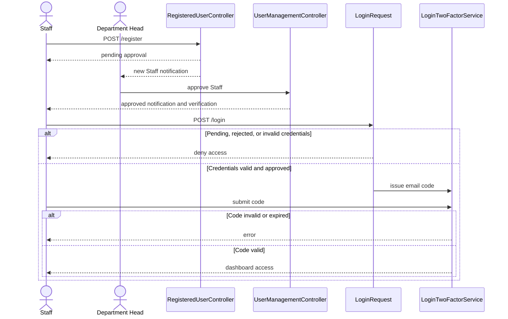

### 17.2 Department Head Invite to Invitee Registration

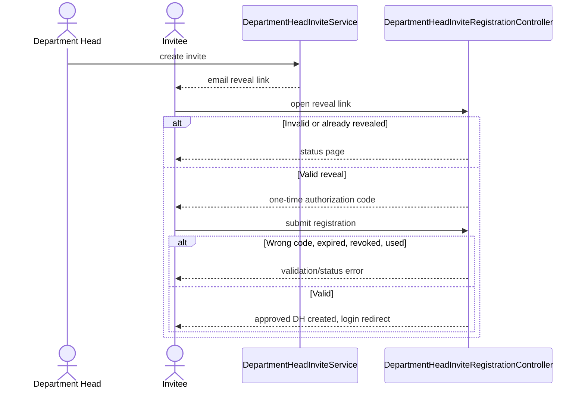

### 17.3 Login With 2FA Including Failure Path

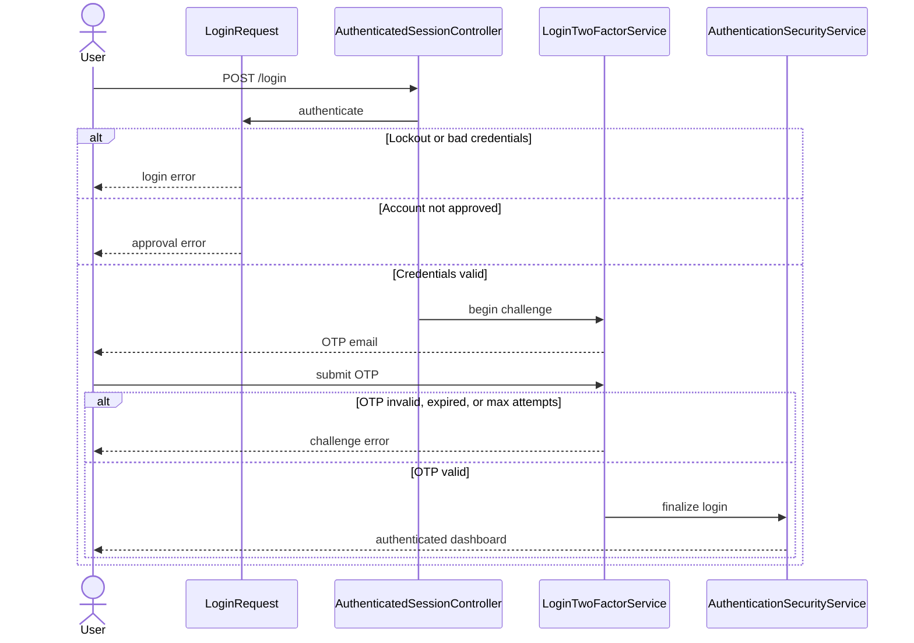

### 17.4 User Account Lifecycle

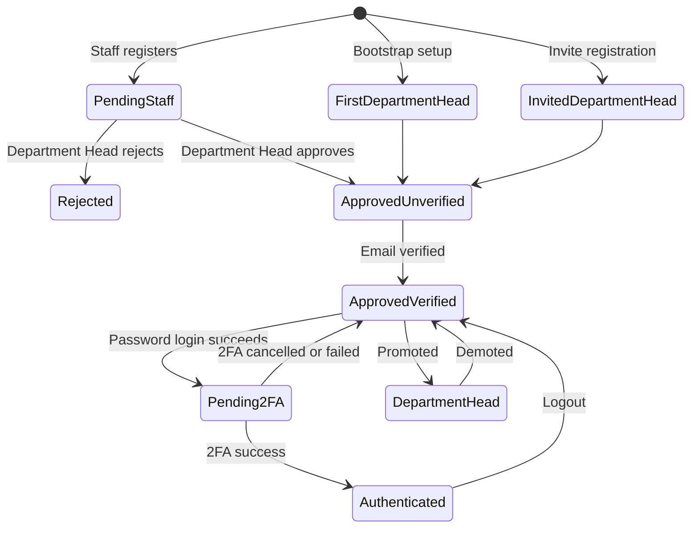

### 17.5 ER Diagram

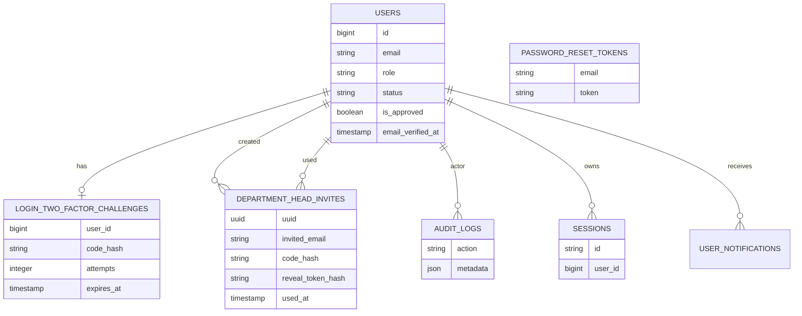

### 17.6 Auth Sprint Component Diagram

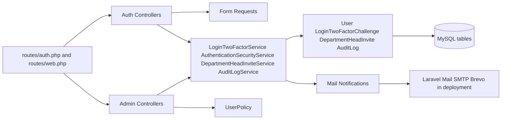

## 18. Report-Ready Paragraphs

### 18.1 Sprint Introduction

The authentication sprint established the security foundation of the Server Room Supervision platform. Its objective was to ensure that access to the monitoring dashboard and administrative modules is granted only to identified, approved, and properly verified users. The implementation extends the Laravel authentication foundation with project-specific account approval, role management, email-based two-factor authentication, and audit logging. This sprint is therefore not limited to a conventional login form; it defines the operational trust model for the whole application. Staff members can request access, but they remain pending until a Department Head validates their account. Department Heads can be bootstrapped securely at project initialization and later invited through a controlled invitation process. This design supports the institutional context of the project, where server-room monitoring data must not be exposed to unapproved users.

### 18.2 Functional Scope of the Sprint

The sprint covers the complete lifecycle from account creation to authenticated session establishment. Staff registration creates a pending account and informs the administrative role that a review is required. Department Heads can approve, reject, promote, demote, and invite users through a protected administration interface. Authentication is strengthened by a second factor delivered by email after password validation. The system also includes standard account recovery through password reset and identity confirmation through email verification. Suspicious-login detection notifies users when a successful login occurs from a different IP address. Each important authentication action is either logged in the audit table or identified in this report as a candidate for future audit coverage.

### 18.3 Authentication and Approval Workflow

The approval workflow separates registration from authorization. A Staff user can submit the registration form, but the resulting account is stored as pending and cannot immediately access the dashboard. Department Heads receive a notification about the new Staff registration and can approve or reject it through the user-management page. Approval changes the user status to approved and enables the next activation steps, including email verification. Rejection keeps the account outside the operational perimeter and informs the applicant by email. This design reduces the risk of unauthorized access because possession of an email address and password is not sufficient to access server-room information. It also mirrors the organizational hierarchy of the project, in which Department Heads supervise Staff access.

### 18.4 Two-Factor Authentication

Two-factor authentication is implemented as an email OTP challenge after successful password validation. The application generates a six-digit random code, stores only its hash, and sets a five-minute expiration period. The challenge is scoped to the pending user and browser session, so the user is not fully authenticated until the OTP is verified. Failed attempts are counted, and the challenge is cleared after three wrong codes. Resending is rate-limited both through Laravel's limiter configuration and a service-level cooldown. On successful verification, the user is logged in, the session is regenerated, the challenge is deleted, and login security metadata is updated. This mechanism significantly improves account security while remaining simple to deploy in a shared-hosting environment.

### 18.5 Role-Based Authorization and Middleware

Authorization is enforced through a combination of middleware and policies. The `approved.user` middleware blocks any user whose account has not been approved, while the `department.head` middleware restricts administrative routes to approved Department Heads. The `pending-two-factor` middleware protects the OTP challenge flow so that only sessions with a valid pending user can access it. The `UserPolicy` adds finer rules for approving, rejecting, promoting, and demoting accounts. These checks prevent Staff users from managing accounts and prevent Department Heads from changing their own role. Route groups apply these middleware consistently to the dashboard, administration, profile, and operational modules. As a result, authorization is centralized enough to be understandable while still allowing action-specific policy rules.

### 18.6 Audit Logging and Security Hardening

The sprint introduces a structured audit log service used by registration, login failure, login success, two-factor events, Department Head invitation events, and user-management actions. Each audit entry records an action key, optional actor, target information, metadata, and timestamp. This provides a useful trace for reviewing sensitive authentication behavior. The implementation also includes rate limiting for registration, password reset, invite creation, invite reveal, invite registration, OTP verification, and OTP resend. Login failures use a throttle key based on normalized email and IP address. Password reset requests intentionally return a generic success response, reducing user enumeration risk. Some security-relevant events, such as logout, password reset completion, and email verification, are not yet audited and should be considered for future hardening.

### 18.7 Department Head Invitation System

The Department Head invitation system avoids open self-registration for privileged accounts. An existing approved Department Head creates an invitation for a specific email address. The invitation stores hashed authorization and reveal secrets, has an expiry date, can be revoked, and can be consumed only once. The email does not directly expose the authorization code; instead, the invitee opens a reveal link that displays the code once. During registration, the invitee must use the invited email and the authorization code. This two-step design reduces accidental leakage of privileged registration credentials. Once consumed, the invite records the new Department Head account and cannot be reused.

### 18.8 Transactional Email Delivery via Brevo SMTP

Authentication relies on transactional email for verification links, password reset links, OTP codes, approval and rejection notifications, Department Head invitations, and suspicious-login alerts. The Laravel code sends these messages through standard Laravel Mail and Notification abstractions. In the documented deployment, SMTP is configured to use Brevo, formerly Sendinblue, as the delivery provider. This is a deployment-level decision made through the standard `MAIL_*` environment variables, not through Brevo-specific application code. There is no Brevo SDK or HTTP API integration in the inspected authentication code. This provider-agnostic SMTP approach keeps the application portable and allows the provider to be changed without rewriting authentication logic. Brevo is appropriate for this context because it offers reliable transactional delivery and a practical free-tier model for moderate project volumes.

### 18.9 Sprint Conclusion and Outcomes

The authentication sprint delivers a complete access-control foundation for the Server Room Supervision application. It combines account approval, role separation, email verification, two-factor authentication, password reset, invitation-based privileged onboarding, and audit logging. The implementation is strongly aligned with the security needs of a supervision platform because access is not granted solely by registration. Department Heads control who enters the system and what administrative privileges users receive. The system also creates useful security traces through audit logs and login metadata. The main areas for future improvement are broader audit coverage, explicit invalidation of other sessions after password changes, and scheduled cleanup of abandoned OTP challenges. Overall, the sprint provides a practical and report-ready authentication layer on which the telemetry, dashboard, reporting, and maintenance modules can safely depend.

## 19. Screenshot Checklist for This Sprint

| # | Page | URL | What to show |
|---|---|---|---|
| 1 | Login page | `/login` | Email/password form, remember checkbox, forgot password link, register link. |
| 2 | Staff registration page | `/register` | Staff form with name, email, department, phone, and password fields. |
| 3 | Pending approval page | `/register/pending-approval` | Message explaining that the account is waiting for Department Head approval. |
| 4 | First Department Head setup | `/setup/department-head` | Setup key form shown only before a Department Head exists. |
| 5 | Department Head invite entry | `/register/department-head` | Invitation entry page explaining invite-based registration. |
| 6 | Invite reveal page | invite reveal URL | One-time authorization code display. |
| 7 | Invite registration page | invite register URL | Department Head registration form with authorization code field. |
| 8 | Email verification notice | `/verify-email` | Notice and resend verification email button. |
| 9 | Two-factor challenge page | `/two-factor-challenge` | Six-digit code form, resend button, cancel option. |
| 10 | Forgot password page | `/forgot-password` | Password reset request form. |
| 11 | Reset password page | reset URL | Token-based password reset form. |
| 12 | Admin users page - pending | `/admin/users` | Pending users table with approve and reject actions. |
| 13 | Admin users page - approved | `/admin/users` | Approved users table with promote and demote actions. |
| 14 | Department Head invite panel | `/admin/users` | Invite creation form and active invite list. |
| 15 | Suspicious-login email | mailbox | Email showing new sign-in alert through SMTP delivery. |
| 16 | 2FA email | mailbox | Email containing the six-digit sign-in code. |
| 17 | Account approved email | mailbox | Approval notification and login action. |
| 18 | Account rejected email | mailbox | Rejection notification. |

## 20. Open Questions (TO VERIFY)

- The exact sprint duration and numbering should be aligned with the official project Gantt; no planning document with week numbers was inspected.
- The deployment SMTP provider is documented here as Brevo based on the audit prompt, but actual production `.env` values were intentionally not read.
- No explicit scheduled cleanup for stale `login_two_factor_challenges` was found in the inspected files; confirm whether an external scheduler or manual cleanup exists.
- No custom trusted-proxy configuration was reviewed for suspicious-login IP accuracy; confirm the production proxy and load-balancer configuration.
- The application uses Laravel's hashing abstractions, but no local `config/hashing.php` file exists in the inspected config list; confirm whether default framework hashing settings are acceptable for production documentation.
- Logout, password reset lifecycle, email verification, and profile email changes are not audited in the inspected controllers; confirm whether this is acceptable or should be added in a future sprint.
- Role names include `staff`, `department_head`, and legacy `it_staff`; confirm whether `it_staff` should remain in the final report or be described only as backward compatibility.
- The report treats Brevo as an SMTP provider only; confirm that no external deployment script adds a Brevo SDK or API integration outside this repository.
